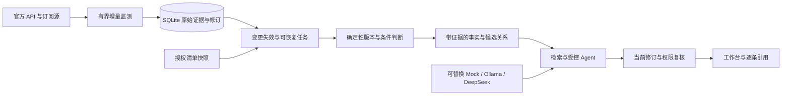
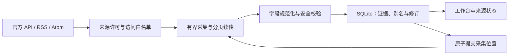

# 知安 · AI 安全知识情报系统

系统已接通三个模块：持续监测、证据富化与授权清单匹配、证据问答。导入一次清单后，新情报、来源修订、撤回和清单变化会自动触发重新评估。每条判断保留来源修订；未知条件、来源分歧和资料缺失不会变成“安全”。

使用 Python 3.11+、标准库与 SQLite，无需安装依赖。首版面向 macOS / Linux；跨进程限流使用系统文件锁。本地数据库、密钥、缓存及原始赛题 PDF 不随代码上传。

```sh
git clone https://github.com/oooooooottttt/zhian-ai-intelligence.git
cd zhian-ai-intelligence
```

## 启动完整系统

在项目目录运行：

```sh
python3 -m aicti_core --provider mock serve --demo
```

访问 <http://127.0.0.1:8849/>。演示库为 `.data/system-demo.sqlite3`，演示漏洞、研究记录和资产均为虚构，官方知识目录另行标注。演示库不联网采集，不混入真实库。Mock 无需 Key，经过规划、工具反馈、综合和提交核验的完整流程；它不证明真实模型的语义质量。可询问“CVE-2099-99001 影响哪些资产，如何修复？”、展开引用、继续追问，再点击“演示来源撤回”，观察旧结论失效和历史修订。演示撤回会保存，重启不会悄悄恢复公告。

需要再次演示撤回前的流程时，可运行 `python3 -m aicti_core --provider mock serve --demo --replay-demo`。它会为虚构公告新增一份有效修订，保留撤回和旧回答的历史，不删除数据库。

在运行服务的终端按 `Ctrl+C` 停止。重新运行上面的命令即可开启；这里使用 `python3 -m aicti_core`，不用 `unicorn` 或 `uvicorn`，地址是 HTTP。

真实监测：

```sh
python3 -m aicti_core serve
```

页面、监测和处理任务同进程启动，默认使用已有 `.data/monitor.sqlite3`。进程保持运行时自动检查到期来源，富化任务每两秒检查新输入；关闭后停止，重新启动从保存位置恢复。页面只监听本机。完整系统和原监测命令兼容同一证据库，但演示库彼此独立。

单次采集、状态查看、无页面后台监测：

```sh
python3 -m aicti_monitor collect
python3 -m aicti_monitor status
python3 -m aicti_monitor watch
```

首次采集按来源回溯 30 天，分页未完成时会显示“接续采集中”。`collect --source nvd-ai --force` 可提前检查一个来源，仍遵守限流与失败退避。页面“检查定时任务”检查到期来源。

查看已有真实结果而不联网：

```sh
python3 -m aicti_core serve --no-collect
```

配置和数据库可在子命令前指定：

```sh
python3 -m aicti_monitor --config config/sources.json --db .data/monitor.sqlite3 collect
```

默认不需要凭据。NVD API 密钥或 GitHub 令牌仅可通过进程环境变量 `NVD_API_KEY` / `GITHUB_TOKEN` 提供；不要写进配置、仓库或数据库。GitHub 仓库公告始终匿名请求，只接收已公开公告。

## 资产与问答

页面支持小表单或 CSV/TSV 清单导入，命令行支持 JSON/CSV。只填写获得授权的部署信息，不导入访问令牌、口令或连接 URL。首版最多 256 项，资产编号使用英文字母、数字、点、下划线或连字符；中文名称另填。`pip/ollama` 客户端不等同于 Ollama 服务端。未知版本填 `unknown`，暴露、认证和能力可以保留未知。

命令行也可导入：

```sh
python3 -m aicti_core import-assets my-assets.json
python3 -m aicti_core process
python3 -m aicti_core ask '哪些授权资产可能受影响？'
python3 -m aicti_core status
```

JSON 示例结构（请替换成真实清单，填写实际观察时间）：

```json
{"assets":[{"asset_id":"inference-01","name":"推理服务","ecosystem":"pip","component":"vllm","version":"unknown","exposed":null,"authenticated":null,"capabilities":{"rag":true,"external_documents":true}}]}
```

清单是用户声明的快照。未提供时间时以导入时间记录，导入前应确认它代表当前情况。超过 24 小时会自动作废旧影响结果并重新评估为待调查；系统不能在不更新清单的情况下获知真实服务升级。

不配置模型时，系统提供明确标记的中文关键词和结构化事实问答；精确漏洞、组件、资产查询走事实路径。本地模型及向量检索分别启用，要求 Ollama 已运行且模型已安装：

```sh
python3 -m aicti_core --model YOUR_INSTALLED_LOCAL_MODEL serve --no-collect
python3 -m aicti_core --model YOUR_INSTALLED_LOCAL_MODEL --embedding-model YOUR_INSTALLED_EMBEDDING_MODEL serve --no-collect
```

V2 同时支持本机事实、Mock、Ollama 和官方 DeepSeek V4 Pro。进入“模型设置”选择 DeepSeek，明确启用云端推理并输入 API Key 后保存；Key 仅存于服务进程内存，清除或重启后需重新输入。命令行也支持 `--provider deepseek`，只读专用 `DEEPSEEK_API_KEY` 进程变量。不要将 Key 写进项目文件或问句。本轮 Key 留空，使用 Mock 验收，没有真实 API 调用。

模型根据当前有界目录规划检索，通过登记的只读工具读取事实与关系，随后输出受 JSON Schema 约束的回答计划。主机保留原始事实卡，单独标记模型建议并核对其引用；最多四次模型生成、六次工具读取和 30 秒总预算。限流、超时、格式错误和无效引用返回具体降级原因。固定本地 Ollama 地址为 `http://127.0.0.1:11434`，不自动安装或启动模型。部署、架构及可复用 Schema 见 [V2 运行与架构说明](docs/system-implementation-v2.md)。

## 系统架构



采用模块化单体，公共入口位于 `aicti_core`，原监测模块保留于 `aicti_monitor`。一份 SQLite 保存原始证据、清单、任务和派生结果；任务使用处理期限与提交资格校验。来源变化时，触发器与采集事务一起使旧结论失效。移除别名或撤回导致实体关系分离时，相关事件进入待核对，由完整分区和版本校验后重新发布。方案说明见 [最终设计](docs/system-design-final.md)，实现和验收范围见 [实现说明](docs/system-implementation.md)。

版本排序只支持明确的数字版本子集及来源提供的精确枚举，复杂 PEP 440/SemVer 等保留未知。NVD CPE 名称不直接转成包范围。CVSS 保留来源评分与向量并检查语法，不重新计算分数。修复版本是来源报告、未自动应用；论文关联仅基于获准元数据。POC 只允许未验证线索，既不下载也不执行。能力风险模式是基于清单的候选假设，不是已确认漏洞。

## 监测流程



来源配置位于 `config/sources.json`，来源使用范围与核验依据见 [SOURCE_POLICY](docs/SOURCE_POLICY.md)。适配器接入约定见 [monitor-contract](docs/monitor-contract.md)。完整系统页面按事件编号倒序展示，可按标题或漏洞别名搜索，并筛选可用、更新中和待核对状态；点击标题查看各来源独立证据及真实修订。AI 相关性是可解释的术语和组件筛选，不等同于风险判断。

跨来源相同 CVE/GHSA 会关联为一个事件，原始证据分别保留。晚到的别名可以关联已有事件；标题相似不自动合并。上游撤回是一个新版本，不删除历史。采集时间变化不会产生虚假的内容修订。

失败或异常时，已提交位置保留；下次接续处理，中断运行会被标记以便追溯。每次来源最多 6 个 HTTP 请求，单响应至多 5 MiB，DNS 等待最多 5 秒，HTTPS 请求绝对截止时间最多 30 秒。请求按域名在当前工作区跨进程限速，支持 `Retry-After` 与 GitHub 额度重置时间。有限完成的页面、数据和续传位置在同一个事务中提交；失败批次整体回滚。

## 来源与使用边界

自动采集本身不是一概禁止。需要分别判断访问许可、请求负载、内容版权、个人信息和再发布条件；公开可见或 robots.txt 允许不能代替内容许可。首版使用官方接口与明确订阅源，不绕过登录、验证码、访问限制或限流。

- NVD：AI 组件关键词范围内的漏洞与已观察 CVE 的更新/撤回，保留 NVD 署名和免责声明。
- GitHub：官方全局公告接口与 vLLM 公开仓库安全公告。Advisory Database 与仓库公告分别记录使用条件。
- arXiv：标题、作者、摘要、分类、论文版本和摘要页链接。描述性元数据属于 CC0；论文 PDF/全文许可另行适用，本模块不下载。
- OWASP GenAI：官方订阅源的标题、日期和链接；默认不保留正文。署名及 CC BY-SA 条件随证据保留。
- NIST：当前征求意见草案和 Cybersecurity Insights 官方订阅，保留标题、链接、日期及使用条件。草案快照不等于所有现行标准目录；消失不视为撤回。
- 官方知识目录：FIPS 203、三项 NIST 指南、欧盟 AI 法案原版共五项人工精选元数据。真实库启动时入库并生成带修订引用的资料事实；不冒充自动法律修订监测。演示库只展示独立目录，不混入其证据。

新来源必须填入准确域名白名单、条款链接、使用范围和 `policy_status`。未完成复核的来源保持关闭；不能为了“全覆盖”采集未获允许的页面。RSS/Atom 只能监测其公开提供的历史和更新，来源不发送的修订/撤回不能凭空获知。

公开来源内容仍是不可信数据：不执行其中的指令、脚本或 POC，不主动连接参考链接，拒绝私网目标、带凭据 URL 与异常重定向。页面使用文本渲染；模型只接收当前许可范围内的事实快照，无法注册或扩大工具权限。问答提交前再次核对来源修订、实体、清单和权限，过期回答不会发布。

## 验证与导出

```sh
python3 -m unittest discover -v
python3 -m aicti_monitor export --output .data/export.json --limit 100
```

离线测试不需要网络和密钥，覆盖分页、增量恢复、更新/撤回、重复采集、别名桥接、事务失败、限流与 URL/XML/展示边界。导出保留来源和使用条件，不意味着获得链接页面或论文全文的再发布许可。

当前回溯和关键词范围是明示的采集边界；未知组件、未索引公告、未公开漏洞以及来源未更新的事实仍可能漏掉。轮询频率也不能直接当作端到端时延保证。原型通过联网实采与离线恢复验证后，再扩充来源和覆盖范围。

当前是可运行原型：不扫描资产，不执行漏洞验证，不自动修改目标服务。配置七个来源、六种类别，政策是人工精选原版元数据。POC 仅保留显式上游 POC 标签；Exploit 标签另存线索，不证明可运行代码。全库覆盖、政策修订监测、真实模型问答准确率与五秒时延仍需评测，虚构演示和离线测试不能证明这些指标。
