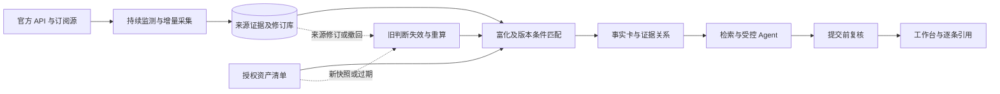

# 知安：服务操作、完整功能与比赛答辩指南

核对日期：2026-10-04。依据当前实现、整合交接和本地原始赛题 PDF（未随代码再分发，共四页）。本文介绍可运行原型，不把设计目标、开发协作或离线测试当成已经达到的比赛指标。

## 1. 开启与关闭服务

打开终端，进入下载或克隆后的项目根目录，目录名不同请相应替换：

```sh
cd 'zhian-ai-intelligence'
```

三种启动方式任选一种，同一端口只运行一个服务：

| 用途 | 命令 | 数据与行为 |
|---|---|---|
| 日常熟悉、离线演示 | `python3 -m aicti_core serve --demo` | 独立虚构库，无联网采集 |
| 真实监测 | `python3 -m aicti_core serve` | 使用真实库，启动到期采集和自动处理 |
| 只看已有真实情报 | `python3 -m aicti_core serve --no-collect` | 不启动新采集，仍处理已有情报及清单 |

然后访问 <http://127.0.0.1:8849/>。地址是 HTTP；当前入口不需要 uvicorn。只打开地址不会启动服务，关闭浏览器标签也不会停止服务。

关闭方式：回到运行服务的终端，按 `Ctrl+C`。如果服务由 Codex 启动、找不到该终端，可在终端查看监听进程：

```sh
lsof -nP -iTCP:8849 -sTCP:LISTEN
```

确认它是本项目服务后，对输出的 PID 执行 `kill PID`，把 PID 换成实际数字；也可让主聊天关闭服务。关闭后网页、监测与后台处理停止，已提交的数据和历史保留，重启后接续处理。

来源撤回演示会保存。需要再次演示撤回前的有效公告时，先停止服务，再运行：

```sh
python3 -m aicti_core serve --demo --replay-demo
```

这会新增虚构修订，不删除旧修订和回答。若 8849 被另一个已确认需要保留的服务占用，也可用 `--port 8850`，并访问对应端口。

可选本地模型需要 Ollama 已运行且模型已安装：

```sh
python3 -m aicti_core --model YOUR_INSTALLED_LOCAL_MODEL --embedding-model YOUR_INSTALLED_EMBEDDING_MODEL serve --no-collect
```

模型名须替换为本机已安装名称。生成与向量模型独立配置；系统不会自动下载、安装或启动模型。当前没有云端 API 实现，真实本地模型尚未端到端验收。

## 2. 系统定位与整体流程

赛题的核心问题是：AI 安全知识分散、人员难以消化和关联、传统系统难以支持自然语言决策。知安将来源信息转换为与授权资产有关、能逐条核验并随证据变化纠正的判断。



架构采用模块化单体：Python 标准库与 SQLite，三大业务模块通过明确契约协作。一份数据库保存原始证据、资产、任务、派生事实和会话，减少首版部署与一致性复杂度。

## 3. 所有已实现功能

### 情报监测

- 自动检查已配置来源的到期任务；首次按配置回溯，之后增量采集，分页未完成保存续传位置。
- 当前五个来源：NVD、GitHub Advisory Database、vLLM 官方公告、arXiv、OWASP GenAI。按配置是四类：漏洞数据库、厂商公告、学术论文、安全社区；两个数据库来源不能重复算两类。
- 当前检查周期分别为 1 小时、2 小时、2 小时、6 小时、6 小时。它们是轮询配置，不能直接当成发布至采集的实际延迟。
- 用漏洞编号/别名关联跨来源事件；相似标题不自动证明同一漏洞。来源证据独立保留。
- 保存上游编号、来源链接、采集时间、发布时间/更新时间、修订、署名与使用条件；上游撤回新增修订，不删除历史。
- 请求数、响应大小、超时、限流和失败退避有界；失败批次不跳过未处理数据。停机重启从提交位置接续。
- 真实情报可通过原监测命令导出结构化 JSON；导出保留来源条件，范围不包含论文 PDF 或 POC 文件。

### 情报富化

- 从明确的结构化来源提取组件、生态、版本范围、修复版本、适用前提、CVSS、CWE 和影响说明。
- 版本匹配区分命中、不在已评估范围、未知；复杂版本、缺失身份、未能完整解析的范围不强行判定。
- CVSS 使用上游评分和向量，检查语法并保留来源；不重新计算评分，也不让模型补无依据数字。
- 论文/分析资料依据明确漏洞编号等关联为直接证据；主题或组件相似只作背景候选。只处理获准元数据，不阅读论文全文实验内容。
- 修复卡保留来源报告的修复版本、条件和未验证状态。没有补丁执行或自动修改目标服务。
- POC 数据结构支持未验证元数据线索及安全链接，生产来源覆盖仍未补齐；不会检查可用性、下载或执行代码。
- 依据清单声明能力显示四类可触发风险候选：外部文档结合工具调用的注入/滥用、外部文档结合 RAG 的检索投毒、工具结合联网的外发风险、工具结合写权限的写入滥用。它们是前提提示，不是已确认漏洞。敏感数据暴露和不可信模型加载规则未通过当前五种清单能力对外开放。

### 授权资产影响评估

- 页面用小表单或 CSV/TSV 导入；命令行支持 JSON/CSV。提交整份清单生成新快照，重新计算影响。
- 支持组件身份、版本、互联网暴露、认证状态、能力及观察时间；当前整份清单最多 256 项，页面单次表格导入最多 100 项、64 KB。
- 新情报、来源修订/撤回、清单变化或快照过期都会触发自动重新评估，不需要用户每次主动提问。
- 结果包括可能受影响、有依据的不在当前影响范围、待调查，并显示判断理由与缺失条件。当前不自动确认服务修复或已遭利用。
- 清单超过 24 小时作废旧影响结果；系统不会从一次导入中自动获知后来真实服务是否升级。
- 这满足授权清单影响评估的一部分需求，尚不具备互联网资产发现、主动探测或漏洞验证。

### 证据问答与 Agent

- 默认中文关键词及结构化事实模式，支持明确漏洞编号、组件、资产问题、上下文续问和会话持久化。
- 回答围绕影响范围、当前清单适用性、修复条件和资料关系组织；每条断言绑定具体证据修订，可点击追溯。
- 支持已有关系上的有限跨文档路径，直接关联与背景关联分开；不据此声称构造完整攻击链或理解任意复杂安全问题。
- 本地生成与向量网关分别选配，接口固定到本机 Ollama；关键词回退会明确标注，不伪装成语义检索。
- 产品中的 Agent 是一个受控模型/工具反馈循环：只登记 `read_facts` 和按需 `relations`，最多 4 次模型调用、6 次工具调用、10 步，问答总预算 20 秒。预算是上限，不是五秒性能承诺。
- 模型可以选择已有事实卡，不能修改事实内容、注册工具或扩大权限。主机独立核对卡片、实体、引用和当前快照，失败退回事实模式。
- 模型或语义检索不可用时降级；回答期间发生资料变化时停止发布过期断言并提示重问。
- 开发时三个 GPT 协作对话属于研发分工，不是产品内的三个 Agent。首版没有多 Agent 自主协作运行。

### 纠正、安全和工程功能

- 来源变更与知识失效随同一事务提交；旧任务即使迟到也必须重新核对输入和处理资格，不能覆盖新结论。
- 撤回后的历史答案保留并提示失效；来源权限收紧时，历史中的受限内容也隐藏。
- 别名桥接撤销或关系歧义使实体进入待核对，支持按原始观察完整分区、附理由及版本确认后重新评估。
- 外部文本是数据，页面按文本显示；公共采集链接校验私网、凭据和重定向等边界。模型没有目标扫描、命令执行或写入工具。
- 本地服务校验请求来源、Host 和写入令牌，使用 CSP 限制页面资源。本机单用户，不是已完成的公网多租户产品。
- 可查看处理任务、来源状态、失败、重试、最后同步和快照时间；可手动继续处理或检查到期来源。
- 已完成 393 项离线测试和本机浏览器流程检查；没有完成容器化、CI/CD、告警和完整 DevOps。

## 4. 四个页面怎么讲

| 页面 | 展示重点 | 用户获得的价值 |
|---|---|---|
| 情报概览 | 事件、可用/更新中/待核对状态、事实卡、资料与历史引用 | 不必逐个来源翻阅；能看到依据和缺口 |
| 授权资产 | 清单编辑/导入、观察时间、能力、逐事件影响 | 把通用情报关联到自己的部署情况 |
| 证据问答 | 中文问题、续问、事实卡、逐条引用、历史状态与处理轨迹 | 回答影响和修复问题，并核验每一步证据 |
| 运行状态 | 来源、许可范围、采集和任务状态、手动继续入口 | 发现失败和积压，了解自动化是否在工作 |

## 5. 与赛题要求的对应关系

比赛原文第 1 页第五条明确三大模块，并额外要求论文、技术标准和政策法规。当前三大模块已串联，论文元数据已有来源；独立安全博客、真实标准/政策适配器、生产 POC 覆盖和互联网资产发现是明确缺口。

初赛评分为监测 15、富化 15、问答 15、性能三项合计 15、Agent 15、自动化 10、文档 15。源数量、规则字段数量和测试数量不能直接换算评分。

| 初赛参考项 | 原文档位 | 当前证明与下一步 |
|---|---|---|
| 监测 | 3/5/7 类，最高档另要求实时 | 当前 5 来源/4 配置类别、周期性增量；类别口径由赛事认定，需补来源并测实际延迟 |
| 富化 | 3 维、5 维以上、准确且自动关联 | 有组件范围、论文关联、清单影响、CVSS/CWE、修复条件等；需证明生产数据的有效覆盖与准确性 |
| 问答 | 关键词、语义加多轮、跨文档深度 | 事实问答、续问及有限路径可演示；真实语义模型与深度题仍需验收 |
| 时效 | 24/12/6 小时 | 需记录发布到首次采集；不以轮询周期代替实测 |
| 富化准确率 | 70%/85%/95% | 需要带人工标注的相关性与字段正确性评测，尚无测得比例 |
| 问答深度与准确率 | 基础至少 70%，良好含推理链，优秀多跳至少 85% | 需按基础、续问、关系、未知与冲突题分别统计 |
| Agent | 基本框架、多角色自主编排、精良且可扩展 | 受控主循环已有实现，真实效果及多角色协作未证明 |
| 自动化 | 核心自动、全流程含异常、自愈 | 有自动处理、限流续传、任务恢复；不能描述为任意故障自动修复 |
| 文档 | 完整清晰、详细设计与流程图 | 实现文档已有，正式报告 Word/PDF、PPT PDF、视频仍需制作 |

决赛有更高要求：语义问答是问答功能合格项；富化性能合格需准确率至少 80% 且召回至少 70%，良好均至少 90%，优秀均至少 95%；问答质量合格需准确率至少 75% 且响应不超过 5 秒，良好需至少 90% 且多跳，优秀需至少 95% 且推理链可解释。多 Agent 编排、容器化/监控和完整 DevOps 是更高档参考项，当前不能声称达到。

## 6. 如果由我答辩

采用“真实问题—系统闭环—现场证据—验证结果—缺口计划”的陈述。以下按约 8 分钟编排，是建议节奏，赛题没有规定统一答辩时长。

| 页/环节 | 内容 | 约用时 |
|---|---|---|
| 1 问题与价值 | 多源信息过载；人需要知道自己的部署是否适用、依据是什么 | 45 秒 |
| 2 架构与分工 | 三模块、证据库、清单、受控 Agent、变更重算 | 60 秒 |
| 3 监测与富化 | 来源范围、增量、关联和版本条件，明确未知 | 60 秒 |
| 4 现场操作 | 资产对比、问影响和修复、逐条引用、撤回后纠正 | 180 秒 |
| 5 Agent 与安全 | 实际工具循环、卡片校验、预算与失败回退 | 45 秒 |
| 6 测试与限制 | 393 项工程测试、真实评测尚未完成 | 45 秒 |
| 7 创新与后续 | 可追溯、可纠正、资产相关；语义评测与覆盖补齐 | 45 秒 |

可直接使用的开场：

> 各位评委，我们的作品是“知安——智能体驱动的 AI 安全知识情报系统”。围绕赛题提出的情报分散、人工关联成本高和决策依据不足，我们将持续监测、证据富化与证据问答串成一个闭环。用户提供授权部署清单后，新公告和后续修订会自动重新评估资产适用性；回答中的每条判断绑定明确来源和修订。我们重点展示的能力，是判断可核验，以及来源变化后旧结论能够及时停止使用并重新计算。

### 现场实操脚本

1. 演示前明确说明全为虚构资料，当前是事实模式。真实监测成果另外准备带来源的真实数据截图，不能拿虚构编号代替。
2. 情报概览：选虚构 vLLM 公告，展开组件、版本范围、CVSS、修复条件以及关联研究，说明背景关联不证明同一漏洞。
3. 授权资产：对比 99.1.0 和 99.2.0 两项清单。前者命中示例范围，后者在当前来源范围外；两者均不是利用验证结果。
4. 证据问答：问“CVE-2099-99001 影响哪些资产，如何修复？”，查看中文事实和逐条引用，展开上游编号、修订和采集时间。
5. 点击演示来源撤回：展示旧答案失效及历史保存，说明系统重新评估并且单来源撤回不能直接证明所有资产安全。
6. 运行状态：展示任务与来源状态，说明异常处理和可恢复流程。若还有时间，导入新清单并观察自动评估。

最强的展示理由是：一次普通问答可以展示检索，一个来源撤回后的完整闭环可以同时展示自动化、证据追溯、并发安全和纠错。

### 常见追问

- **“Agent 在哪里？”** 可选模型在固定权限下选择事实或关系工具，读取反馈再继续或结束。采集和版本判断由代码完成；当前是一个受控主循环，开发协作不能当成产品多 Agent。
- **“为何不让模型自由生成？”** 首版优先让关键事实、版本和修复条件有明确来源，模型负责选择；主机复核后才发布，减少无依据断言。代价是开放式深度分析有限，需要后续评测扩展。
- **“准确率 95% 有没有证据？”** 当前没有该实测。393 项是工程测试，后续用独立标注集分别测准确率、召回和延迟。
- **“资产是否真的存在漏洞？”** 这是清单和公告的适用性评估，不是探测或成功利用；配置未知、复杂范围或清单过期就保留待调查。
- **“论文、POC、标准政策都完整了吗？”** 论文只覆盖许可元数据，POC 只有未验证线索结构，标准政策暂无生产适配器，均在材料中明示。
- **“是否满足本地部署？”** 核心本机可运行，模型网关也固定本地。赛题要求自行部署，没有明确写必须禁止云端 API；当前未实现远端接口。

## 7. 必须准备的提交材料

初赛：技术报告 Word 与 PDF 各一份，操作演示视频，技术讲解 PPT 的 PDF。报告应包含架构、Agent、三模块、技术选型、流程图、实现和核心代码说明、效果、性能及创新；建议前 1–2 页做亮点预览。

决赛：按主办模板准备答辩 PPT，不能出现单位、人名等识别信息；另交技术报告 Word/PDF 和演示视频。原文说明源代码由企业在参赛平台审阅，不单独提交。

当前最优先的补齐顺序：实测本地模型与语义检索；建立标注题集并测准确率/召回/完整响应时间；补安全博客、标准与政策的许可来源和真实关联案例；再决定多角色工具编排、生产 POC 线索或部署工程化的增益和工期。没有测量结果的指标只写目标。

## 参考文件

- 本地原始赛题 PDF（未随代码再分发）：赛题九文件，第 1–4 页。
- [使用说明](../README.md)
- [实现说明](system-implementation.md)
- [整合交接](handoffs/system-integration.md)
- [来源配置](../config/sources.json)

上一版最终架构稿记录设计阶段方案，含尚未实施目标；介绍当前功能应以实现说明和整合交接为准。
