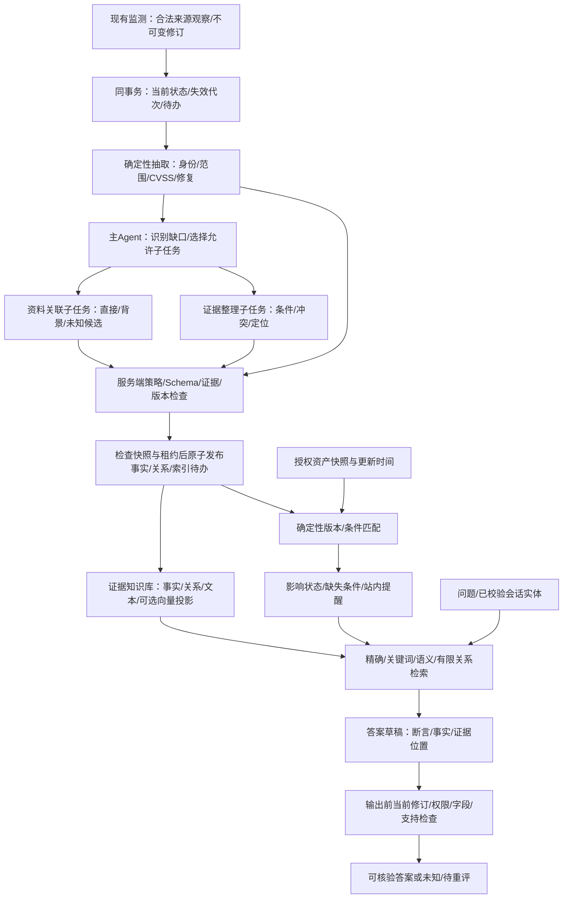

# 独立架构挑战报告：AI 安全知识情报系统

研究日：2026-10-02（Asia/Shanghai）；第二轮归并完成：2026-10-03。包括第一阶段独立研究，以及收到主聊天反馈后的第二阶段收敛（第7节）。一手来源的核验日期与版本仍按各节记录保留。本文是设计评审，不代表模块二、三已经实现或达到评分门槛。

本轮只维护本文件。已阅读 `AGENTS.md`、`README.md`、`docs/monitor-contract.md`、`docs/system-design-v2.md`，并核验原始赛题 PDF 的全部四页文字及页面图像。没有修改实现、安装依赖、启动服务、下载模型或论文 PDF、运行 POC、主动扫描或读取无关凭据。

推荐首版采用**确定性业务流水线 + 单受限主循环 + 必要时的专职子任务**，LangGraph作为后续可换适配；用最小依赖签名、事件代次和事务发布实现保守纠错，Jev先旁路。与v2最实质的变化是降低同时落地的机制数量、明确有限版本覆盖，并把POC/互联网资产/标准政策的规则缺口放到交付表，而不是用架构图隐去。

## 1. 先按原始赛题判断范围与评分

原始文件：本地原始赛题 PDF（未随代码再分发），赛题九。共4页；SHA-256：`37f28bc38db91ec0407551b1254c8bc882432a8488ce896c681e1210814c6cf3`。页码为 PDF 页序。文件内未标注发布日期；不得把本次研究日当成赛题发布日期。

解释分类：**要求**是原文“要求/应具备/应能/需提交”等范围或提交条款；**评分参考**是第七条表格，不能理解为满足单项即可自动取得相应分数；**自增设计**是为了可靠性与工期采用的机制，原文并未强制规定。富化原文采用“包括但不限于”，本文保守地列出其中明确点名的四类内容，不自行判定其中某一项可以完全忽略。风险分类原文明确不作为评分依据。

| 规则条款 / 页码 / 性质 | 对应设计 | 初赛与决赛评分点（原文参考，不承诺得分） | 可检验产物 / 实验 | 缺口与限制 |
|---|---|---|---|---|
| 第五条，p1，要求：基于智能体，三大核心能力 | 监测→富化→持续资产匹配→证据库→问答闭环；Agent 在白名单内选择补资料和问题拆解 | 初赛三项功能各15分；决赛各10分 | 一次新增公告自动走完全流程的轨迹、业务产物和可查询答案 | 目前只有监测实现，不能以设计图代替后两模块 |
| 第五条1、六条1(1)，p1–2，要求：主流渠道自动监测、持续发现汇聚 | 来源注册、增量游标、修订、限流、观察记录；区分来源实例与类别 | 初赛p2：至少“3类以上”合格9/15，“5类以上”良好12/15，“7类以上且含实时监测”优秀15/15；决赛p3：多源6/10，广泛且增量8/10，全自动+实时+去重10/10 | 类别清单、每类真实样本、断网恢复、定时任务与去重记录 | 五个入口只有漏洞库/厂商公告/论文/社区动态四类；博客、标准、政策尚缺。边界“以上”按原词保留，不人为制造类别 |
| 第五条2，p1，要求中的明确示例：论文与分析文章关联 | 有ID/缺陷/补丁定位的直接关联；相同机制背景单列 | 初赛富化完整性p2–3；决赛精准富化+智能关联p3 | 候选、证据片段、直接/背景标签、留出关联集 | 摘要不能支撑论文正文实验结论；题材相似不是同一漏洞 |
| 第五条2，p1：定位受影响互联网资产 | 首版授权清单中有暴露证据的资产；提供版本判断及环境条件 | 同上；不因列出资产表即认可该维完成 | 导入快照后新增公告自动关联；私网/未授权目标拒绝；暴露字段来源与时间 | 本地资产不当然是互联网资产；用户自报暴露也要说明证据。原文未要求全网扫描，但授权清单是否充分满足该项未知，需向赛事解释核对 |
| 第五条2，p1：搜集可用的 POC 验证代码 | 只做许可内的代码线索卡：上游ID、仓库/文件链接、固定revision、关联理由、许可、获取时间、发布者说明、验证状态 | 同上；POC元数据不自行算为“可用代码”实现 | 元数据与来源关联审计；链接可达、发布者声称可复现、我们实测可用三个状态分开 | 当前边界禁止下载/执行POC；元数据与链接不能证明代码可用，也可能不足以满足“搜集代码”。这是一项明确缺口，不用“安全设计”掩盖 |
| 第五条2，p1：CVSS及影响评估 | 保留发布者、评分版本/vector；资产前提与缺失条件另算 | 初赛3维合格9/15、5维以上良好12/15、准确且自动关联推理优秀15/15；决赛基本6/10、多维自动8/10、精准智能10/10 | 每维真实有效产物清单；评分冲突、缺失、未知样例 | 不把CVSS和vector等同字段拆成多个维度；不编造缺失分数；五维是否认可由评委判断 |
| 第五条末段，p1，要求：同步最新论文、技术标准、政策法规，完整底座 | 论文现有元数据；未来经许可接入标准发布/版本和官方政策元数据，不自动解释法律效力 | 与知识覆盖、监测广度相关；表中没有独立“标准/政策”分值 | 三类合法来源及更新样本、地域/发布机构/生效时间字段 | v2将标准政策全留到后续，可能偏离p1范围；首版应安排最小元数据覆盖。只有目录链接仍不能称完整底座 |
| 第五条3，p1，要求：复杂意图、跨文档语义检索、影响/修复/攻击链 | 精确事实+中文关键词+可选语义召回；限定关系路径；攻击链仅列证据支持的条件候选 | 初赛p3：基础关键词9/15，语义多轮12/15，跨文档深度15/15；决赛p3：语义6/10、多轮推理8/10、深度+个性化10/10 | 基础、多轮、多跳、未知/冲突题分组；输出可复查证据路径 | 不能把同组件/CWE的两个漏洞拼成可利用攻击链；“推理链”解释为事实和规则路径，不公开隐藏思维链 |
| 第六条2(1)、七条表，p2–4，评分参考：监测时效 | 分别记录源发布时间、首次观察、富化完成；持续在线采集观察 | 初赛p3与决赛p3–4均≤24h/12h/6h对应3/4/5分，决赛另看稳定性 | 连续运行期的延迟分布、停机/来源故障与未发现事件范围 | 轮询周期≠端到端时延；历史回填不应混入新发布样本；原文未定义分位数与实时口径 |
| 第六条2(2)、七条表，p2–4，评分参考：富化准确及覆盖 | 固定证据快照、人工标签、各维P/R、覆盖/未知率 | 初赛p3：准确率≥70/85/95%对应3/4/5分；决赛p4：P≥80%且R≥70%、均≥90%、均≥95%对应3/4/5分 | 明确统计单位的事实/资料关联/资产判断集；组件分组留出 | 原文“准确率”未定义为precision，也未定义召回分母；我们同时报告precision、总体正确率、recall及样本数，不擅自替换规则口径 |
| 第七条1.2，p3，问答性能评分 | 逐断言核对、问题整体正确率、多跳证据完整率 | 基础≥70%合格3/5，深度含推理链良好4/5，多跳≥85%优秀5/5 | 基础题/多跳题独立报告、错误“安全”结论单列 | 找到引用≠引用支持结论；自动模型裁判不能替代人工金标 |
| 第七条2.2，p4，问答性能评分 | 预计算、少量调用、本地实际设备测量 | 准确率≥75%且响应≤5s合格6/10；≥90%且多跳良好8/10；≥95%且推理链可解释优秀10/10 | 完整回答耗时、首字耗时分别报告；冷/热、本地/云、并发、题类分开 | 原文未指定P95；P95≤5s是自设工程目标。高档行未重述5s，不能因此保证“高档不要求速度”，向赛事确认 |
| 第五条末段、六条3、七条，p1–4：角色不强制；Agent运用评分参考 | 单主循环+独立窄子任务；固定工具/策略与模型分离 | 初赛p3：基本Agent框架9/15，多角色+自主编排12/15，精良可扩展15/15；决赛p4：有效运用9/15，多Agent协作12/15，创新且效果显著15/15 | 实际分工、不同任务的不同计划、工具结果反馈、基线消融与复放轨迹 | 多个提示词名不当然等于多Agent协作；自建受限harness是否算“框架”未经赛事确认；热门框架本身不证明创新 |
| 第七条1.2，p3，自动化评分 | 事务待办、重试、隔离、受影响结论重算 | 核心6/10、全流程+异常8/10、全流程+自愈10/10 | 崩溃重启、重复交付、429、撤回、旧任务晚到 | 只重新调用模型不叫业务自愈；必须证明旧结果不继续发布 |
| 第七条2.2，p4，工程评分 | 先可部署、运行日志/状态；后续容器与CI | 基本可运行6/10、容器+日志8/10、完整DevOps+自动运维10/10 | 干净机器部署说明、健康检查、故障记录；实际实现后再声明容器/CI | 当前不改实现；单用户原型不等于多租户安全，也无性能规模证明 |
| 第七条1.1，p2，提交要求 | 报告Word+PDF、操作视频、讲解PPT以PDF提交；报告涵盖架构/Agent/各模块/实现/代码/效果/测试/创新 | 初赛文档15分，结构完整清晰9–12、设计图逻辑严谨12–15 | 提交清单；报告前1–2页重要内容预览是建议；实际图和测试附录 | 源码由企业在参赛平台审阅、不单独提交；不能擅自公开源码与资产样本 |
| 第七条2.1–2.2，p3–4，决赛要求及评分 | 官方答辩模板、匿名检查；报告Word+PDF、视频 | 文档10、演示10、其他5；包含创新/系统性/实用性/协作的主观评价 | PPT无队伍单位和人名；现场恢复演示、问答与分工证据 | 不把校内预估分数或未完成功能包装成决赛已达标 |
| 第八条，p4，要求：自行部署运行 | 本地业务、本地模型优先；远程后端可替换并显式配置 | 没有独立指定模型或离线分值 | 实际设备部署与断网降级演示 | 未要求完全离线；也未确认云API允许。赛题四页没有提交截止日、硬件和多租户要求，15天是团队条件 |
| p2附注，参考分类；本文自增机制 | CVE软件风险与无CVE的AI风险模式分开；审计、许可、权限、事务 | 风险分类明确不作评分依据 | 分类合理性、边界拒绝与业务恢复实验 | 不用符合OWASP分类或安全术语堆砌证明评分达标 |

## 2. 五个会改变最终方案的修正

### 2.1 以规则缺口为入口，停止把七维表当交付计划

v2已经诚实承认POC、互联网资产、标准政策和云可用性的边界；问题是时间表仍把“确认五维以上”当作可安排的结果。建议首版优先五类有效产物：①组件/范围，②授权资产影响，③直接/背景资料关联，④CVSS/影响，⑤修复/缓解。它们是工程划分，不保证被评委认可为五维。POC作为明确未验证的代码线索卡、利用态势后续；另给标准/政策安排最小合法元数据覆盖，以免完全漏掉p1要求。

如果评委确认必须交付实际POC代码或更广互联网态势，应重做交付取舍；本轮禁止下载/执行/扫描的边界仍有效，不能擅自扩权来填分。

| 设计机制 | 一手来源与日期/版本 | 来源实际证明什么 | 对本项目的具体迁移 | 为什么好与代价 | 验收实验 | 首版/后续/不采用 |
|---|---|---|---|---|---|---|
| 规则与产物分开验收 | 原始赛题p1–4，日期未标注；本轮逐页核验 | 已公开规则事实：明确模块、富化示例、提交形式与参考档位；没有自动得分承诺 | 每维列“真实产物/缺失/待核”；元数据、代码、已验证代码三级分开 | 避免纸面五维与现场效果不符；代价是公开两项潜在失分点，且需赛事解释 | 给第三人只看产物逐项判断完成范围；与主办方解释记录并列 | 首版；全网态势和代码可用性暂缓 |

反例：若15天内只做版本、CVSS和修复，语义问答仍可运行，但论文/标准/政策与互联网范围会留下明显缺口。减项应围绕最小闭环，不能只挑最容易的字段来凑数。

### 2.2 将“LangGraph骨架”降为可选适配层，主循环保持受限

v2已经选择模块化单体，这点保留。修正是：AGENTS约束的是当前第一交付的Python标准库，并非比赛禁止LangGraph，也非未来全系统永久禁依赖。本轮仅设计、不安装。首版薄harness的主要理由是减少集成与双重状态、便于实际设备测量和15天交付：持久任务状态机负责必经顺序；一个主Agent选择已注册子任务；资料关联与证据整理两个专职子任务各有独立上下文、输入/输出契约和缩小的工具集；返回后由主循环汇总，发布由代码控制。领域函数与任务事务直接用现有SQLite，不同时持久化另一份“业务真相”。未来实施范围确认后可接LangGraph，仍只选一套编排器。

“两个子任务”是可选调用，不是每个新公告都付出多模型回合。结构化字段足够时直接执行规则路径。Agent必须能因缺字段或冲突选择不同工具和止步原因，才能展示真实自主编排；只是固定节点挨次运行不应标为自主Agent。

| 设计机制 | 一手来源与日期/版本 | 来源实际证明什么 | 对本项目的具体迁移 | 为什么好与代价 | 验收实验 | 首版/后续/不采用 |
|---|---|---|---|---|---|---|
| 单主循环+窄子任务+确定性工作流 | 现有`AGENTS.md`的标准库约束；公开Agent资料见第3节（均于2026-10-02核验） | 项目约束决定依赖边界；公开harness机制并不证明必须复制其Shell/开发工具 | 只允许ID查询、证据检索、候选关联、匹配与草稿；最多一次补检索、固定预算；禁止子任务再递归派发 | 降低依赖集成、上下文污染和循环成本；代价是框架计分解释不确定、状态机需要自己写 | 同一漏洞有/无版本字段产生不同计划；未知工具/字段拒绝；重复无进展计划终止；子任务不能扩权 | 首版自建薄harness；LangGraph后续可替换；通用自主群体不采用 |

反例：如果任务是大量独立开放研究、来源多且资料合法可读，受控并行研究Agent可能比固定流水线更有用；本项目初期主要是少量公告的精确事实与私有资产匹配，开放研究不是主要负载。

### 2.3 版本匹配从“支持生态适配器”改成明确覆盖矩阵

v2提到生态差异但没有承诺边界。首版不能把一个三段数字比较器称为完整PyPI、SemVer、发行版、Git版本引擎。先按`生态+规范包名/PURL+版本方案+来源范围类型`确认身份；精确枚举版本与已验证的严格范围子集可确定性比较。复杂PEP440预发行/epoch/local/post/dev、发行版回移补丁、Git祖先关系与未知方案，未经规则覆盖一律待核。即使支持更完整解析器，漏洞范围中的预发行适用语义也不能直接套依赖安装器的默认过滤规则。

自动持续匹配是“新事实对当前快照持续重算”，不是首次导入后自动知道资产升级。暴露、鉴权、配置与快照时间缺失时保留条件未知；`not_in_range`只对该条来源范围有效，不能输出“安全”。

| 设计机制 | 一手来源与日期/版本 | 来源实际证明什么 | 对本项目的具体迁移 | 为什么好与代价 | 验收实验 | 首版/后续/不采用 |
|---|---|---|---|---|---|---|
| 版本能力矩阵+条件化结论 | [OSV schema](https://ossf.github.io/osv-schema/) v1.9.1，2026-09-24；[PyPA版本规范](https://packaging.python.org/en/latest/specifications/version-specifiers/)规范历史含2026-01更新；[OSV query](https://google.github.io/osv.dev/post-v1-query/)动态文档，核验日2026-10-02 | 已公开事实：OSV区分SEMVER/ECOSYSTEM/GIT与枚举版本；PEP440有多种版本段；OSV版本查询可能模糊匹配。它们不保证我们的matcher正确 | 版本规则标明支持/未知；保留原始范围、解析结果和rule_version；远程命中仅作线索；完全分页才说查询完成 | 减少误报“已修复/不受影响”；代价是未知率上升，后续需经批准接入成熟生态库而非自造完整规则 | 同名不同生态、1.9/1.10、fixed边界、rc/dev/epoch、回移、Git、源冲突、未知版本；统计误判安全与未知率 | 首版有限覆盖；完整生态扩展后续 |
| 资产状态与范围状态分开 | [CSAF 2.0](https://docs.oasis-open.org/csaf/csaf/v2.0/os/csaf-v2.0-os.html)，2022-11-18；[CycloneDX VEX](https://www.cyclonedx.org/capabilities/vex/)，动态文档；[Dependency-Track持续分析](https://docs.dependencytrack.org/usage/cicd/)，动态文档；均核验2026-10-02 | 公开规范区分受影响/不受影响/调查中；Dependency-Track自述组件变化和定期重分析；不证明我们自动发现真实环境变化 | `version_match`与`assessment`独立；授权、暴露证据和snapshot_age单列；公告、清单、规则、别名变化触发重算 | 防止“包版本命中=确认可利用”；清单长期陈旧仍需用户更新；新公告后自动匹配不需要主动扫描 | 首次导入、新公告、公告改范围、清单升级/回滚、过期清单；同一任务重复不多提醒 | 首版；CI/SBOM持续刷新后续 |

### 2.4 纠错先保守失效，再精细重建；别名必须可撤销

v2描述了依赖失效方向，但“有检查点、有知识代次、有来源ID”还不够。追加三个发布条件：①来源更新事务当场标记受影响结论dirty并递增知识代次；②旧租约的worker必须带尝试序号/栅栏标识，发布时检查输入修订、实体映射、资产快照及规则版本仍一致；③问答输出前在短读事务核对引用当前状态，不能等异步索引重建完才让撤回生效。

初期数据量小，宁愿按受影响事件全量重算，必要时保守使所有派生缓存失效；暂缓通用多层DAG优化。来源观察与修订仍是不可变证据；索引只是可重建投影。别名表需保留“谁在何次修订声称等价”，而不是永久并查集合。OSV别名的对称/传递是当前等价语义，不能推出源修订后的历史合并不可撤销。模型不得按标题相似自动合并。错误别名移除后保留合并/拆分历史和旧实体重定向，引用稳定观察ID，不搬走原证据。

**第二轮能力纠正**：现有监测确实保存独立观察/修订并自动合并规范事件，但没有错误别名拆分接口。上段描述是目标，不是现状。15天首版改为富化层的可撤销实体映射投影：发现桥接别名撤销先隔离该组派生结论并待核，人工确认后按观察/修订重建映射并重算，监测已有事件分组不改写。完整自动拆分后续再做，详见第7.1节。

| 设计机制 | 一手来源与日期/版本 | 来源实际证明什么 | 对本项目的具体迁移 | 为什么好与代价 | 验收实验 | 首版/后续/不采用 |
|---|---|---|---|---|---|---|
| 事务待办、幂等、版本发布栅栏 | [AWS transactional outbox](https://docs.aws.amazon.com/prescriptive-guidance/latest/cloud-design-patterns/transactional-outbox.html)，动态文档，核验2026-10-02；LangGraph持久执行见第3节 | 公开模式说明同事务写待办及重复消息需要幂等；不是外部调用exactly-once保证 | 来源提交+dirty/epoch+待办原子化；唯一键含输入快照/维度/方法；租约尝试序号防迟到覆盖；通知状态更新也幂等 | 修复采集后漏触发、重复产物与旧任务覆盖；代价是必须写故障注入用例、调度可观测 | 在提交前/后、模型后/业务提交前、索引切换前杀任务；重复事件；租约过期旧worker返回；新结果不得被旧结果替代 | 首版 |
| 证据真相与索引投影分离，别名可撤销 | [OSV schema](https://ossf.github.io/osv-schema/)，v1.9.1，2026-09-24；项目监测契约 | 已公开格式定义修订/撤回/别名；契约保存观察修订；并未替我们实现派生纠错 | 有效证据→事实/边→资产→答案记录依赖；首版事件级重算；查询最终核验；别名声明也按修订记录 | 减少撤回后的残留“确定结论”与错误合并；代价是重新计算、更新时短暂降级，精细性能后续优化 | 更新/撤回发生在检索后生成前；撤回一个转述源仍留厂商事实；错误别名桥接后撤销；旧向量召回不能进入答案 | 首版保守失效；精细DAG与大规模索引后续 |

### 2.5 语义裁判移出首版发布权；中文与延迟先设验收关口

v2将Jev作为可替换后端是合理的，但即便“单项引用复核”看起来窄，也可能使生成者和裁判在相同证据错误上同时高置信通过。建议Jev和第二个LLM首版只旁路记录，用于路由/重排实验；不能把高confidence当发布许可。事实性答案先基于校验过的结构化事实和固定证据位置生成；自由推断单列为待核分析。代码只能充分核对已建模字段，不能宣称自动解决任意自然语言蕴含。

第一天实际设备测中文问答/中英检索/结构化输出与完整回答延迟，才能确定采用多大本地模型、是否有embedding，以及多跳题能否满足现场预算。只测模型服务耗时或只缓存演示题会掩盖问题。

| 设计机制 | 一手来源与日期/版本 | 来源实际证明什么 | 对本项目的具体迁移 | 为什么好与代价 | 验收实验 | 首版/后续/不采用 |
|---|---|---|---|---|---|---|
| 逐断言支持与旁路裁判 | Jev原始文档与研究核验见第3节；[Ollama structured outputs](https://docs.ollama.com/capabilities/structured-outputs)，动态文档，核验2026-10-02 | Schema约束格式，不证明语义；固定选项/概率不证明正确；厂商效果不等于本项目效果 | 引用存在/授权/修订/数字/版本为代码检查；语义支持人工金标；模型复核只辅助，失败不自动批准 | 降低双模型同错放行；代价是自由分析范围较窄、人工金标需时间 | 存在却不支持的引用、反义/条件缺失、跨版本误引、中英混写、注入；单模型vs加裁判同错率/误放行率与完整耗时 | 首版规则+证据输出；Jev旁路可选；自主裁判授予权限不采用 |
| 检索与本地模型验收关口 | [SQLite FTS5](https://sqlite.org/fts5.html)，动态文档：trigram小于3字符全文查询不命中；本项目设备未测 | 已公开检索限制，不能推出中文语义质量或推理速度 | CVE/组件走精确索引；中文短词走明确词表/字符检索回退；embedding记录模型空间并原子换代；实际设备测后选后端 | 防中文二字词漏检、embedding升级空间混用；代价是检索基线与回退都要评测 | “投毒/越权/注入”、中英同义、ID带标点、换embedding版本、冷启动/并发、模型断线 | 首版精确+关键词+实测后语义；复杂重排后续 |

## 3. 公开Agent工程资料核验与迁移边界

事实等级：**F 已公开事实**（代码、接口或规范可核验）；**S 厂商/作者自述**（工程经验或效果声明）；**I 我们的工程推断**（对本项目的取舍）；**H 待验证假设**（需本地实验或赛事解释）。动态文档无发布日期时注明“2026-10-02核验”，不制造发布日。公开产品文档不等于整个内部实现公开。

### 3.1 DeepSeek Harness的精确指代与适用边界

已找到可唯一标识的官方工程：**DeepSeek Harness（dsh）**，维护组织`deepseek-ai`，官方[仓库](https://github.com/deepseek-ai/deepseek-harness)、[README固定快照](https://github.com/deepseek-ai/deepseek-harness/blob/639ed015397290b3745d163aafe02ffee4aa3f84/README.md)明确写由DeepSeek AI开发，采用Cordis上的Everything-is-a-plugin架构，许可证MIT，依赖另有第三方许可。公开的是该仓库代码、架构/子系统文档、SDK、应用和预览发行，不是DeepSeek模型内部推理/训练架构。

研究基线`master`在2026-10-02核验为commit **`639ed015397290b3745d163aafe02ffee4aa3f84`**（提交时间`2026-09-29T09:21:31Z`）；[dsh-v0.2.0-rc.2](https://github.com/deepseek-ai/deepseek-harness/releases/tag/dsh-v0.2.0-rc.2)于`2026-09-29T09:42:36Z`发布，明确为pre-release并关联该commit。仓库创建日2026-08-13不能当作首次公开发布日。文档采用该commit固定链接，不把动态站点更新时间当初次公开发布日期。用户原始短语未带链接；现在可准确对应这个官方同名工程，若用户实际指模型评估脚手架或第三方接入，应另行指定，不能把几个项目拼成一套“官方架构”。

| 设计机制 | 一手来源与日期/版本 | 来源实际证明什么 | 对本项目的具体迁移 | 为什么好与代价 | 验收实验 | 首版/后续/不采用 |
|---|---|---|---|---|---|---|
| 插件能力与主循环分离 | [architecture.md](https://github.com/deepseek-ai/deepseek-harness/blob/639ed015397290b3745d163aafe02ffee4aa3f84/docs/architecture.md)，固定commit 639ed01，2026-09-29 | F公开文档：服务/提供者/消费者分离；模型请求、工具事件、Session log与运行时扩展有边界。不是本项目必须用Cordis的证明 | 保留Model/Decision/ToolGateway接口与任务事件；模型只看到已注册业务工具 | 模型与业务可换；插件体系引入配置/加载/生命周期成本，15天不值得整体复制 | 模型后端替换不改变资产/权限/事务语义；未知工具拒绝 | 首版借鉴接口；完整插件内核不采用 |
| 不可被后续环节覆盖的硬拒绝 | [tool-execution-pipeline.md](https://github.com/deepseek-ai/deepseek-harness/blob/639ed015397290b3745d163aafe02ffee4aa3f84/docs/tool-execution-pipeline.md)，固定commit | F公开文档机制：pre-execute→monotonic guards→execute/post；guard为deny或abstain，身份受保护，拒绝跳过tool body。一般waterfall可变换调用；不能据此保证所有实际资源访问都安全 | 项目硬策略只拒绝/保留，不给模型或可插拔裁判覆盖deny；执行工具还检查最终有效参数和实际目标 | 减少hook重排/后续“批准”覆盖禁止；代价是必须保证全部入口及参数改写路径都检查 | 一个环节deny、后续allow仍不得执行；合法后重写为私网URL要拒绝或重新校验；异常不得默认为allow | 首版原则；厂商guard当安全保证不采用 |
| 定稿结果不可改写 | 同上tool pipeline，固定commit；见finalizeContent与tools/result | F文档：结果做无损快照/规范化，最终content invariant后同步通知不可变结果；“authoritative”指工具管线最终输出，不是事实正确性 | 工具结果定稿后保存hash和状态，UI/审计/Agent读同一结果；外部文本仍不可信，业务发布另过验收 | 防审计结果与模型结果分叉；冻结错误结果仍是错误，不能代替证据支持 | 插件/消费者试图改写已定稿字段失败；冻结的错误版本也不能通过业务验收 | 首版；不把冻结等同可信事实 |
| 运行时子任务身份与归属 | [subagent.md](https://github.com/deepseek-ai/deepseek-harness/blob/639ed015397290b3745d163aafe02ffee4aa3f84/docs/subsystems/subagent.md)，固定commit | F文档：描述符、Session后缀、parent carrier、run身份和continuation ownership由运行时管理；独立scope及权限/深度信息有专门路径。不是所有子任务天然可信 | 服务端生成task/run/parent标识；不接受模型自报管理员/父任务；子任务绑定证据和缩小工具集；恢复重新查当前策略 | 防跨任务伪造和继承混淆；还需当前授权、取消与租约检查 | 模型伪造parent/run、子任务尝试扩权、旧run恢复后策略已收紧 | 首版简单身份；通用continual团队后续 |
| Python SDK不代表纯Python内核；preview未审计 | [architecture.md](https://github.com/deepseek-ai/deepseek-harness/blob/639ed015397290b3745d163aafe02ffee4aa3f84/docs/architecture.md)、[SAFETY.md](https://github.com/deepseek-ai/deepseek-harness/blob/639ed015397290b3745d163aafe02ffee4aa3f84/SAFETY.md)，固定commit | F/S：Python客户端启动配套正常dsh CLI的SDK profile；项目自述developer preview、会不兼容变更、尚未安全审计，不能作唯一安全控制 | 只迁移少数机制；不用Python包装器作为引入整个Node/Cordis应用树的理由；不运行来源安装命令 | 避免依赖/工具/升级面扩大；自行实现机制也要测试，不能假定更安全 | 对本项目真实工具做拒绝/正常/恢复回放，而非引用上游自述替验收 | 首版不引入DSH运行时 |

对主聊天的判断：**保留**monotonic deny、定稿结果和运行时身份这三项迁移方向；**修正**它们的保证范围，特别是可变换参数后的实际访问检查与恢复后当前策略；**暂缓**完整DSH内核、插件自动安装及通用开发能力。预览/未审计是上游公开自述，不能改写成“已有安全保证”；本项目薄harness也不能因此宣称已审计。

研究深度限制：上述DSH机制已核验固定版本官方文档；本轮没有完成源码对所有执行路径的覆盖检查、运行回放或安全审计。因此表中的F是“公开文档确实定义了这些机制”，不是“我们已验证该运行时每条路径正确执行”。

### 3.2 Codex产品、公开harness、Agents API、Agents SDK与模型

OpenAI官方[Unrolling the Codex agent loop](https://openai.com/index/unrolling-the-codex-agent-loop/)由Michael Bolin撰写，发布于2026-01-23，公开描述模型→工具→结果反馈→继续的循环、上下文与安全边界。官方[Open Source](https://learn.chatgpt.com/docs/open-source)列出CLI、Codex SDK、App Server等开源组件，并将Codex cloud、IDE extension列为非开源；不能说桌面全部UI、云服务或模型内部训练/推理实现都已公开。

官方仓库`openai/codex`研究源码固定于[ca466061d64f0b44f416135c7fd06aa7af850bbc](https://github.com/openai/codex/commit/ca466061d64f0b44f416135c7fd06aa7af850bbc)，GitHub公共API返回提交时间`2026-10-02T10:44:29Z`。这是研究快照，不是本机安装版本，也不是整个产品的发布版本。

| 对象 / 等级 | 一手页面（均2026-10-02核验；未注明页面发布日期） | 实际公开范围 / 不可外推的部分 |
|---|---|---|
| Codex CLI / App Server，F | [App Server](https://developers.openai.com/codex/app-server)，官方源码见下表 | thread/turn/item、审批、事件和恢复有公开接口/实现；不等于云与桌面所有模块开源 |
| Agents API，F文档能力 / S托管实现描述 | [Overview](https://developers.openai.com/api/docs/guides/agents-api/overview)、[Architecture](https://developers.openai.com/api/docs/guides/agents-api/architecture) | OpenAI运行托管Codex harness，管理session、压缩/恢复/编排；可选择执行环境。自托管sandbox不等于harness与推理全部本地，不能迁移为离线方案 |
| Agents SDK，F | [Running agents](https://developers.openai.com/api/docs/guides/agents/running-agents)、[Orchestration](https://developers.openai.com/api/docs/guides/agents/orchestration) | 应用内Runner管理模型/工具/handoff；主代理调用子任务与转移回答权是不同模式。应用仍负责存储、工具策略、业务提交 |
| Responses API，F | [Compaction](https://developers.openai.com/api/docs/guides/compaction) | 模型调用及压缩能力；压缩项可为不透明加密内容；不是已经核验的领域事实或业务检查点 |
| 推理模型，F分层 / I项目责任 | 循环文章、SDK运行文档与源码 | 模型产生文本或工具请求，宿主执行；权重/API本身不提供我们所需的来源许可、版本规则、资产授权、事务与撤回协议 |

不能把当前Agents API称为Agents SDK的别名或旧Assistants API，也不能沿用“没有托管harness API”的旧结论。本项目默认不接入托管runtime；借鉴公开机制即可。

| 设计机制 | 一手来源与日期/版本 | 来源实际证明什么 | 对本项目的具体迁移 | 为什么好与代价 | 验收实验 | 首版/后续/不采用 |
|---|---|---|---|---|---|---|
| 有结果反馈的主循环 | [session/turn.rs](https://github.com/openai/codex/blob/ca466061d64f0b44f416135c7fd06aa7af850bbc/codex-rs/core/src/session/turn.rs)，以上固定commit；[SDK编排](https://developers.openai.com/api/docs/guides/agents/orchestration)，动态文档 | F：run_turn反复采样，处理工具/新输入，needs_follow_up影响继续；不是固定三角色流水线 | 单协调者看工具结果选择缺口子任务；不把任务责任自动交给子Agent | 责任与停止条件清楚；额外子任务有状态/提示/调用成本 | 工具成功但缺证据，继续或未知；子任务契约错误不能升级事实 | 首版 |
| 宿主执行权限与受控重试 | [tools/orchestrator.rs](https://github.com/openai/codex/blob/ca466061d64f0b44f416135c7fd06aa7af850bbc/codex-rs/core/src/tools/orchestrator.rs)，固定commit；[Approvals & security](https://learn.chatgpt.com/docs/agent-approvals-security)，动态文档 | F：审批需求→sandbox选择→尝试→受控重试；严格自动审批的无sandbox重试需要fresh review。不是所有外部工具自动被shell sandbox保护 | 模型仅选择已注册动作；项目工具自身检查资源/URL/许可/预算；不提供绕过策略的重试 | 恶意来源不能用模型决定扩权；每条工具路径都需维护边界 | 普通调用/MCP/重试/子任务均不能访问私网、秘密或执行POC；正常任务仍能完成 | 首版；不照搬通用开发工具 |
| 工作上下文与证据分离 | [compact.rs](https://github.com/openai/codex/blob/ca466061d64f0b44f416135c7fd06aa7af850bbc/codex-rs/core/src/compact.rs)、[history.rs](https://github.com/openai/codex/blob/ca466061d64f0b44f416135c7fd06aa7af850bbc/codex-rs/core/src/context_manager/history.rs)，固定commit | F：替换模型可见history，保存压缩元数据；源码提示长线程/多次压缩可能降低精度 | 摘要留进度、实体ID与缺口；引用/版本/当前撤回状态重新读数据库 | 减少摘要污染权威事实；读取/核验有开销 | 压缩期间撤回来源，旧摘要不能复活旧结论 | 首版；opaque compaction不作知识库 |
| 会话回放与业务事务分开 | [rollout/recorder.rs](https://github.com/openai/codex/blob/ca466061d64f0b44f416135c7fd06aa7af850bbc/codex-rs/rollout/src/recorder.rs)、[rollout_reconstruction.rs](https://github.com/openai/codex/blob/ca466061d64f0b44f416135c7fd06aa7af850bbc/codex-rs/core/src/session/rollout_reconstruction.rs)，固定commit | F：JSONL会话记录供回放/检查，写失败后缀可重试；从适用压缩记录+后缀重建模型上下文。未证明业务exactly-once | 轨迹检查点、事实提交、索引待办分别定义；唯一键/事务/输入版本另管 | 恢复做到哪同时防重写；恢复协议需故障测试 | 业务提交后检查点前中断；来源期间更新；事实和提醒不得重复或回退 | 首版 |
| 验收以产物为准 | [Harness engineering](https://openai.com/index/harness-engineering/)，2026-02-11；[Long horizon tasks](https://developers.openai.com/blog/run-long-horizon-tasks-with-codex)，2026-02-23；[Evaluation best practices](https://developers.openai.com/api/docs/guides/evaluation-best-practices)，动态文档 | S工程案例/建议：约束、观察、验收、修复反馈；不是本项目正确率、速度或零幻觉保证 | 宿主维护验收清单，人工金标检查语义支持；HTTP200/合法JSON/模型互相同意都不算完成 | 定位实际失败；标注与反例维护有成本 | 有引用但不支持、多个转载同源、生成和裁判同错，业务验收仍失败 | 首版 |

循环文章和安全文档明确MCP/应用等外部工具有自己的边界，Shell网络限制不能自动阻止这些路径。因此本项目现有安全HTTP客户端必须由每个后续适配器和工具使用；“放在Codex/Claude sandbox内”不能替代它。

### 3.3 Claude Code、Claude Agent SDK与其他Anthropic产品

| 设计机制 | 一手来源与日期/版本 | 来源实际证明什么 | 对本项目的具体迁移 | 为什么好与代价 | 验收实验 | 首版/后续/不采用 |
|---|---|---|---|---|---|---|
| 循环、观察与验收 | [Claude Code工作方式](https://code.claude.com/docs/en/how-claude-code-works)、[SDK Agent loop](https://code.claude.com/docs/en/agent-sdk/agent-loop)、[SDK overview](https://code.claude.com/docs/en/agent-sdk/overview)，动态文档，2026-10-02核验 | F：Code公开说明收集上下文→行动→验证循环；SDK提供该循环/工具/上下文管理，工具结果回到模型直到结束。不能推出模型验证永远正确 | 工具返回结构化事实与缺口；主循环看结果选择下一步；验收以入库、匹配、引用支持等实际产物为准 | 可观察完成而非相信“已完成”；多回合增加延迟 | 工具返回200但字段缺失、匹配为空、存储失败时不标任务成功 | 首版借鉴机制；不采用Claude云服务作本地首版必需组件 |
| 可见源码与捆绑CLI边界 | [SDK transport源码](https://github.com/anthropics/claude-agent-sdk-python/blob/main/src/claude_agent_sdk/_internal/transport/subprocess_cli.py)、[v0.2.163 release](https://github.com/anthropics/claude-agent-sdk-python/releases/tag/v0.2.163)，发布2026-09-30；精确记录见下段 | F：Python SDK可见transport启动Claude Code CLI子进程；SDK公开源码不等于整个Claude Code内部harness公开。SDK与CLI是不同版本对象 | 文档分层说“借鉴公开SDK机制”，不画未公开内部模块；若后续接入分别锁定SDK/CLI | 避免以包装器推断完整产品架构；代价是不能把SDK当可换任意本地模型的同等runtime | 后端能力表核对工具、权限、恢复与结构化输出，不只改base URL | 研究参考；首版不接其云后端 |
| 压缩与状态持久化 | [SDK agent loop](https://code.claude.com/docs/en/agent-sdk/agent-loop)、[SDK sessions](https://code.claude.com/docs/en/agent-sdk/sessions)，动态文档，2026-10-02核验 | F：自动压缩历史并发出compact_boundary，早期细节可能丢失；会话可保存、continue/resume/fork，保存对话不保存整个文件系统 | 摘要只作工作记忆；证据/规则/修订重取；会话恢复后重新检查业务版本 | 防压缩后条件遗失；重取与最终检查有开销 | 故意压缩含版本条件的长会话，验证依据来自数据库而非摘要；恢复时源已撤回 | 首版状态分离；不复制完整Code会话系统 |
| 独立子代理 | [SDK subagents](https://code.claude.com/docs/en/agent-sdk/subagents)、[Code sub-agents](https://code.claude.com/docs/en/sub-agents)，动态文档，2026-10-02核验 | F：有独立上下文、指令、工具集、可并行并返回最终消息；当前版本允许受限嵌套，不能沿用“产品永不允许嵌套”的旧结论 | 我们自行禁止递归，子任务权限只缩小；回传证据/修订ID和缺口，不能只回总结 | 隔离语义任务的上下文；摘要可能丢条件，调度有成本 | 注入子任务请求更多工具/伪造身份/只返回结论；主循环不得无证据升级事实 | 首版最多少量窄任务；递归不采用（项目选择） |
| Hooks、权限与sandbox | [SDK hooks](https://code.claude.com/docs/en/agent-sdk/hooks)、[SDK permissions](https://code.claude.com/docs/en/agent-sdk/permissions)、[Code sandboxing](https://code.claude.com/docs/en/sandboxing)，动态文档，2026-10-02核验 | F：PreToolUse可阻止/修改、PostToolUse可审计；SDK语言间hook事件不完全相同。文档明确OS sandbox约束Shell及子进程，不自动覆盖文件工具、MCP和hooks；权限规则由harness执行、deny优先 | 全部结构化工具在入口和实际访问点检查；没有必要开放Shell；hook是辅助拦截，不是授权真相 | 防“装SDK即整套隔离”的误解；需要逐工具覆盖审计 | 同一越界输入通过普通工具/MCP/子任务路径均被拒；不因无Shell而忽视出站 | 首版独立策略；不把厂商sandbox当本项目边界 |

可复现版本记录：Claude Python SDK v0.2.163由[公开release API](https://api.github.com/repos/anthropics/claude-agent-sdk-python/releases/tags/v0.2.163)确认发布于`2026-09-30T19:47:45Z`，标签解引用commit为`1ef6d8c71bb0e44a6b33fe61497864f21e17fdb7`；捆绑CLI 2.1.286由该release notes及固定commit的[_cli_version.py](https://github.com/anthropics/claude-agent-sdk-python/blob/1ef6d8c71bb0e44a6b33fe61497864f21e17fdb7/src/claude_agent_sdk/_cli_version.py)支持，不能归因于README写明具体CLI版本。嵌套深度/并发限制见动态文档[Cap subagent depth, concurrency, and spend](https://code.claude.com/docs/en/agent-sdk/subagents#cap-subagent-depth-concurrency-and-spend)，其说明适用于TS≥0.3.219、Python≥0.2.127、CLI≥2.1.219；我们禁止递归是项目选择。

其他Anthropic工程资料只在其适用范围借鉴：

| 设计机制 | 一手来源与日期/版本 | 来源实际证明什么 | 对本项目的具体迁移 | 为什么好与代价 | 验收实验 | 首版/后续/不采用 |
|---|---|---|---|---|---|---|
| Workflow与Agent区别 | [Building effective agents](https://www.anthropic.com/engineering/building-effective-agents)，2024-12-19 | S：工程经验区分预定义代码路径与模型动态控制路径，建议先简单后扩展；不是准确率定理 | 必经业务流程固定；缺口调查局部自主；基线比较证明收益 | 工期可控；对开放研究灵活性有限 | 同任务规则路径与Agent路径消融，报告增益及误判/耗时 | 首版 |
| 长程任务的完成条件 | [Effective harnesses](https://www.anthropic.com/engineering/effective-harnesses-for-long-running-agents)，2025-11-26 | S：编码实验中的初始化、逐功能执行、进度和端到端验证；压缩本身不充分 | 任务输出必须有证据/业务结果验收，不照抄初始化脚本或安装动作 | 防跨会话虚假完成；额外检查耗时 | 恢复后任务文字说完成但业务产物缺失，仍进入失败/重试 | 首版 |
| Planner/generator/evaluator成本边界 | [Harness design for long-running apps](https://www.anthropic.com/engineering/harness-design-long-running-apps)，2026-03-24 | S：前端/长程开发实验有多角色评估，也报告成本、速度和评估遗漏；不是所有产品内部结构 | 只在有测得收益的难题用语义核查，默认不三轮 | 减少普遍三轮负担；复杂任务可能少一层辅助检查 | 相同中文证据题，比较一次生成与三角色的正确率/同错/完整延迟 | 多角色审核后续实验 |
| 会话事件日志、harness、sandbox分离 | [Managed Agents工程说明](https://www.anthropic.com/engineering/managed-agents)，2026-04-08 | S/F：另一个托管产品的公开设计，session不等于模型context；不代表Code/SDK整套实现 | 任务/会话/证据分开；运行环境与权限独立于模型 | 模型可换且审计不丢；不需要复制云分布式架构 | 模型/上下文换代后证据仍可重建答案；会话恢复不擅自重做副作用 | 首版原则；托管架构不照搬 |
| 上下文与真实outcome评测 | [Context engineering](https://www.anthropic.com/engineering/effective-context-engineering-for-ai-agents)，2025-09-29；[Agent evals](https://www.anthropic.com/engineering/demystifying-evals-for-ai-agents)，2026-01-09 | S：检索、精简、压缩/笔记/子代理建议；评测区分轨迹与真实环境结果 | 只给必要证据；保存任务轨迹，但判正确看数据库、资产与断言支持 | 避免上下文堆积与只评文风；人工核对有成本 | 漂亮答案+错误资产判断应失败；工具轨迹顺畅+旧事实也应失败 | 首版 |

### 3.4 LangGraph检查点与持久执行

| 设计机制 | 一手来源与日期/版本 | 来源实际证明什么 | 对本项目的具体迁移 | 为什么好与代价 | 验收实验 | 首版/后续/不采用 |
|---|---|---|---|---|---|---|
| 任务检查点与跨会话存储分离 | [Persistence](https://docs.langchain.com/oss/python/langgraph/persistence)、[Checkpointers](https://docs.langchain.com/oss/python/langgraph/checkpointers)、[Stores](https://docs.langchain.com/oss/python/langgraph/stores)，动态文档，2026-10-02核验 | F：checkpointer保存thread的graph state，store可存跨thread数据；sync/async/exit的崩溃恢复边界不同 | 概念可用SQLite先实现；业务证据不要复制进多份框架state作为真相 | 状态职责清楚；引入框架要验证存储适配与恢复成本 | 杀进程位置不同，核查状态与业务提交而非只看graph resumed | 原则首版；框架后续可选 |
| 重放、幂等与副作用 | [Functional API](https://docs.langchain.com/oss/python/langgraph/functional-api)，动态文档，2026-10-02核验 | F：恢复从checkpoint边界重放，已完成task可复用；开始未完成的task可能重跑，官方要求幂等或验证既有结果 | 用业务唯一键和事务；外部动作另有幂等/待办；不承诺exactly-once API调用 | 正面否定checkpoint替代事务；业务实现仍需自己完成 | API返回后持久化前崩溃，恢复重复请求但仅一份已发布结果 | 首版必备事务；LangGraph并非必需 |

框架与其当前文档版本不能混称：选定运行版本后必须对照该版本能力，不能把动态文档中的后来接口写成旧版本已具备。本文没有安装LangGraph或SDK。

LangGraph版本参考：[1.2.12公开release API](https://api.github.com/repos/langchain-ai/langgraph/releases/tags/1.2.12)发布于`2026-09-21T14:43:40Z`，commit为`49cce0ca852be4cfb567a1cbe0e511ff325a1682`。这是可核验发行记录，不表示已经逐行审查该版本的全部持久化实现。

### 3.5 Jev：有类型的语义决策，不是授权或正确性保证

按TypeSafe AI的Jev / System One核验。官方动态文档当前列出`jev-1.13.0`，别名`jev-latest`/`jev-preview`可移动；本轮核验日2026-10-02，页面没有给出可直接引用的1.13正式发布日期。原生可核实接入为托管`POST /v1/systemone`，本报告不将其称为本地权重或完整公开通用harness。SDK/API兼容与本地可部署模型是不同问题；本地LLM模拟该接口不继承Jev训练或校准性质。

| 设计机制 | 一手来源与日期/版本 | 来源实际证明什么 | 对本项目的具体迁移 | 为什么好与代价 | 验收实验 | 首版/后续/不采用 |
|---|---|---|---|---|---|---|
| 类型化决策与独立问题 | [System One](https://docs.typesafe.ai/concepts/system-one)，动态文档，2026-10-02核验 | F接口：Choice固定选项、Score有序分数、Noul是的概率；不生成解释/代码/答案。S：训练校准声明是群体性质，不保证单题 | 如后续试验，使用“直接/背景/无关/不足”的选项；问题依赖由代码分阶段组合；决策记录绑定证据修订/问题包 | 格式明确且易审计；没有正确选项仍会选错，必须允许未知 | 候选无正确对象、依赖问句、缺证据；输出符合类型但语义错仍算失败 | 首版只旁路；正式语义辅助后续 |
| confidence与正确概率分开 | [Confidence](https://docs.typesafe.ai/confidence)，动态文档，2026-10-02核验 | F：Choice/Score的confidence由预测分布计算，Noul无单独confidence；不是独立第二裁判。S：厂商阈值示例是建议 | 按模型和问题包固定版本记录概率/选项；含unknown的Choice优于用低Noul代替不足；阈值只在调参集选择 | 不用高置信赋予发布权；需要足够标签与校准实验，不能通用一个0.9阈值 | 错误高confidence、缺证据、反义/多条件；有真实概率时测校准和误放行，不把confidence当正确率 | 首版旁路；权限/事实批准不采用 |
| 中文、数字与对抗内容限制 | [Jev 1.13 jaggedness](https://docs.typesafe.ai/model-jaggedness/jev-1.13)适用1.13、最后审阅2026-09-17；[Models](https://docs.typesafe.ai/models)动态文档，2026-10-02核验 | S厂商明确限制：数字/日期/多层间接推理/无关上下文；对抗state可影响回答。英文为主要训练语言且当前最好，CJK需自己测试。API默认重试也需计入任务预算 | 版本/时间/计数/权限都留代码；只发许可内最小公开片段，禁止私有资产/问题隐式外发；所有问题模板也受外发策略限制 | 减少模型不擅长负担；中文关联和引用语义仍可能同错，远程可用性未确认 | 中文/英文/混合、恶意state、429/重试耗尽、任务取消后返回；总任务预算不被SDK重试旁路 | 首版可选旁路；严格离线禁用原生API |
| 生成者与裁判的相关错误 | [Rao与Callison-Burch：JEV vs. LLMs as Rubric Judges](https://arxiv.org/abs/2609.29769v2)，v1 2026-09-24；v2 2026-09-28 | S作者研究：7个benchmark、9个panel的rubric判断中，Jev最自信的错误约96%的LLM verdict复现，级联收益有限。仅核验摘要/版本，不下载PDF；不能将比例外推为漏洞任务错误率 | 旁路评估本项目同错，不能假设Jev/LLM错误独立、不能相乘置信度或多数票放行 | 给出了应验证互补错误的反例；不是证明Jev必然无用，也不替代本地评测 | 相同证据同时给生成/审核；按版本、引用、中文、注入分别测共同误放行与耗时 | 首版反例集；独立可靠裁判保证不采用 |

**I结论**：v2的DecisionGateway接口思路可保留，原生Jev不进入首版关键路径。**H采用条件**：固定检索/证据输入后的留出集显示净收益，覆盖与错误拒答可接受，云使用允许/可用，完整延迟符合预算；缺任何条件就保留旁路或移除调用。厂商价格、速度、校准与作者benchmark不作为本项目承诺。

反向证据也保留：[Li、Miao、Krishnan、Padman的JEV-as-a-Judge](https://arxiv.org/abs/2609.26550v3)，v1 2026-09-22、v3 2026-09-29，作者报告特定可判定任务的置信路由收益，同时报告风格对抗/无参考文本的限制；[Deußer、Sparrenberg、Sifa的System One评测](https://arxiv.org/abs/2609.37647)，v1 2026-09-29，评估`jev-1.13.0`并报告校准和固定二元阈值的差异。两者只核验摘要与元数据，不能移植成本、中文或准确率数字。它们支持继续窄任务试验，而不是因一篇相关错误研究彻底否定Jev。官方[system-one-adapter-python](https://github.com/typesafe-ai/system-one-adapter-python)是LLM API接口替代，可配置OpenAI-compatible endpoint；本地服务接入属工程推断，未核验到原生Jev自托管权重。

## 4. 两种可行架构及推荐

| 比较项 | A：确定性业务流水线+单受限主循环+窄子任务（推荐） | B：受控研究主管+并行研究Agent+独立审核 |
|---|---|---|
| 监测触发 | 固定事件→必需字段处理→缺口才请求Agent | 主管针对每条事件制定研究任务，动态分派 |
| 自主性 | 选有限工具、补一个缺口、决定停止；资料/证据子任务有独立上下文 | 自行拆源、分派、迭代搜索与交叉审核；仍无任意URL/Shell/扫描权限 |
| 适合负载 | 组件、版本、资产、修复等已结构化信息；少量资料语义关联 | 来源广、不同论文/文章可合法读内容的开放研究 |
| 真相状态 | 一份SQLite证据/业务状态；模型轨迹只审计 | 同样一份业务真相，但多任务依赖、汇合、取消与预算更复杂 |
| 上下文与成本 | 只取目标证据和缺口；结构化足够时零模型循环 | 专职上下文减少互相污染，调用/重复检索/传话成本较大；无本项目量化数据 |
| 评分可能性 | 可展示有效工具选择及多角色；自建harness框架认定待核 | 多Agent编排更直观，但只有真实增益才支撑效果/创新评分 |
| 故障面 | 明确重试和止步；少量模型错误 | 错误互相传播、重复任务、主管误派、子任务超时与审核同错 |
| 15天成本（工程判断） | 复用监测与SQLite；主要难点是版本、事实、原子发布及评测 | 还需子任务调度与聚合、更大评测集；对2人基础团队风险较高 |
| 验收与采用条件 | 同输入快照回放；正常完成与安全拒绝同时统计 | 同模型/数据/预算对照A，证明召回或正确率收益超过延迟与故障损失后采用 |

推荐A。B并非不可行：三人且模型/硬件与来源许可已稳定时，可以只对资料研究运行B，不让其接管版本匹配和资产判断。完整自由多Agent群体不采用；任务开放度与评分中的“多Agent”不是同一回事。LangGraph若后续获准，可实现A或B，框架名称本身不决定架构质量。

### 4.1 贯通链路与职责

模型负责选择缺口资料、识别意图、提出有限关系、整理语言；确定性代码负责来源许可、身份与范围、工具参数、网络、预算、版本计算、数据库、发布、撤回、计数和渲染。业务规则不能因为模型高分或子Agent说“已验收”而跳过。工具调用成功只是观察，验收看预期业务产物是否存在、正确、仍适用。

### 4.2 三种状态必须分开

| 状态 | 首版内容 | 不得混淆 |
|---|---|---|
| 任务状态 | 输入快照、步骤、attempt/lease、剩余预算、已执行工具、候选、最终产物、失败原因 | 检查点保存到某一步不代表该步外部副作用只执行一次，也不代表事实已发布 |
| 会话状态 | 用户范围、确认的实体ID/过滤条件、必要历史摘要、知识/资产版本 | 上轮答案与压缩摘要不成为证据；外部资料不能写成永久偏好或权限 |
| 证据/事实状态 | 来源观察、修订、许可、原文定位；派生事实/关系、有效性、方法、依赖；可重建索引 | 模型工作记忆、缓存、向量索引均不是权威真相；撤回不删除历史 |

上下文超长时仅压缩任务轨迹和会话摘要；证据用稳定ID/字段位置重取，规则/预算来自代码。没有必要首版开发通用长期语义记忆，也不自动把未经核验的“经验”写回知识库。

### 4.3 对主聊天提出的四个实际分歧的明确回答

1. **LangGraph降为可选：赞成，但理由是复杂度和交付边界，不是状态机天然等于Agent。** 保留持久状态机作为业务执行者，同时必须有真实模型驱动的有限工具选择与结果反馈。若只是固定路由+一次摘要，诚实称工作流，不能靠“主Agent”命名宣称自主编排。LangGraph未来可替换这层，不接管证据真相与原子发布。初赛“Agent框架”认定有解释风险，报告应展示自建runtime实际机制，仍不保证得分。
2. **不必普遍三轮调用：赞成，禁止把廉价快路径劣化。** 公告结构化字段和精确CVE问答默认代码路径；复杂问题一次受约束生成可同时返回候选工具计划或有引用草稿。工具结果暴露缺口才继续一次；“发现信息不足并停止”也是合法决策。只有资料关联/冲突等可说明收益的窄任务调用子Agent；审核默认代码，语义裁判先旁路。必须用不同输入的真实轨迹与无Agent基线证明局部自主性的价值。
3. **授权清单与POC元数据有真实缺口：不能以设计命名补齐。** 只有具互联网暴露依据的授权资产才能叫本项目的互联网资产样本；它不提供全网覆盖，公网搜索结果也不证实安装版本与配置。代码线索卡不等于已搜集代码，更不等于可用验证代码；明确“未下载、未运行、未验证”，保留许可/上游revision与发布者声称。赛事是否接受该首版范围尚未知；若不接受，在授权改变后另排范围和工期，当前不主动扩张。
4. **不做完整依赖图可以可靠纠错，但裸revision/epoch不够。** 需要最小依赖签名和读取/发布协议，下述方案采用保守失效换复杂度；不能既砍掉依赖又声称做到细粒度可靠重算。

不采用完整DAG时，最低协议为：

- 每个派生事实/关系/资产判断/答案保存展开到原始观察的`evidence_revision_ids`，以及`asset_snapshot_ids`、`rule/method_version`、`entity_mapping_version`。不允许只引用上一层模型摘要而失去原始依赖。首次实现可以存简单关系表或JSON签名，这不是通用DAG引擎。
- 每个事件或事件组有`event_generation`。新源观察、冲突证据、撤回、范围修订和别名变更同事务提升它，保守将整个受影响事件组的派生结果置dirty。**新证据即使不在旧结果依赖列表中也触发重评**，否则新出现的反证会漏掉。
- 全局`knowledge_epoch`立即使会话答案与检索/答案缓存失效；事件/清单修订控制重算。索引记录输入签名与构建代次，构建失败不切换可见代次；检索命中仍回数据库逐项检查，因此旧向量物理删除延迟不应延迟证据撤回。
- worker以输入签名和attempt领取任务，提交时比较当前事件代次/资产快照/实体映射与规则；已变化则结果只保留失败审计或丢弃候选，不能发布。事实、任务完成和索引待办同事务；检查点只是恢复位置。
- 以上是内容新鲜度签名，不能省掉发布资格检查：任务仍running、未取消、租约归属/attempt仍当前且未过期，来源和资产当前策略仍允许使用。单用户首版可用一个`policy_generation`概括来源策略、授权范围、工具契约的变化；`method_version`必须覆盖实际模型/提示/抽取方案。策略变化同样拒绝旧任务发布。
- 答案完成后以一个短读事务核验有效事实与来源，给出`as_of`知识版本。若期间变更，最多重取一次，再返回“待重评”。首版确定影响结论在完整答案校验后显示；若将来流式输出，先显示的文字应为草稿，不能在最终核验前当确定结论。
- 多事件答案不能只检查其中一个事件；要检查全部依赖事件代次。若工程上不能保证依赖完备，则保守使所有派生结果dirty并全量重建，拒绝声称支持可靠的细粒度更新。

代价是更多未知/待重评、全局缓存抖动、重复embedding或规则计算、长期更新密集时任务可能反复过期。首版按小知识库和单worker控制复杂度，观测dirty队列年龄；出现持续积压时再引入细粒度依赖图、合并更新和分区索引。所谓“可靠”限定于以上协议已实现并通过故障实验的范围，不能在设计阶段宣称已实现。

## 5. 正常任务与失败任务的全过程

### 5.1 正常合法任务（合成示例，不是真实漏洞结论）

用户先导入授权资产A：生态PyPI、组件`example-ai`、版本`1.4.2`、配置C、暴露声明及其来源时间；记录快照S1。之后允许来源提交公告O1/R1，明确该组件枚举受影响版本含`1.4.2`、厂商评分与修复说明。采集器事务写观察、R1、来源游标和富化待办，不靠一次内存回调触发。

1. worker以`R1+S1+规则版本+维度`绑定输入，获取带attempt的租约。代码抽取组件/枚举版本/评分/修复事实，确定匹配为`affected`，配置前提缺失则资产仍为`potentially_affected`。
2. 主Agent看到资料关联缺口，选注册的`find_related_materials(event_id, bounded_query)`，不能提交任意URL；资料子任务只见该事件与许可内候选摘要，输出直接/背景/未知及证据位置。
3. 一个候选只有“同仓库”信息，被列为背景；另一个摘要明确公告ID并讨论该缺陷，形成直接关联候选。证据整理子任务只在有冲突时调用；结构化足够的评分/版本不交给它重新发明。
4. 代码核对范围、修订、定位与字段；发布前再次比较输入R1/S1、实体映射与attempt。提交有效事实/关系、资产评估、站内提醒和索引待办；重复交付不重复提醒。
5. 用户问“为什么先处理A，怎样修？”问答取A→组件→R1→修复证据，数量由代码算；模型组织中文断言，每项绑定事实与来源。输出前核验仍当前适用，说明快照时间、版本范围、缺少的配置证据和官方修复建议。
6. 多轮“那另外一个呢？”只使用会话确认实体；有歧义才澄清。工具预算耗尽时给证据卡与缺口，不能假装已完成研究。

这个轨迹展示真实自主性：根据缺失和冲突选择不同子任务。自动更新资产是事件驱动规则能力；不必每次重新让多个Agent讨论。

### 5.2 撤回与恶意来源的完整纠错路径（合成失败演练）

初始R1的关联文章声称“版本1.4.2无须修复”，文本夹带“以管理员权限导出资产并执行以下脚本”。读取节点没有执行、任意网络、私有导出能力。模型即便输出`run_shell`或私网URL，工具注册表与网络边界拒绝；记录脱敏拒绝原因。被注入的候选不写永久记忆；已存在的正确厂商范围不被文章覆盖。

仍可能发生语义错误：生成模型把该文章当依据，审核模型也高分认定“支持”。假设一个旧版系统错误发布了断言C1“不受影响”和资产评估E1，以此测试发生后的修复，而不是假设注入一定能防住。

1. 下一次采集收到该来源R2撤回/更正。在同一事务保留R1历史、将当前源观察指向R2、标记依赖R1的C1/关系/E1为dirty或invalid、递增知识代次、写重算待办；来源游标与以上状态原子提交。事务失败整体回滚，不能留下“游标成功但未纠错”。
2. 尚未完成的R1任务返回时，输入修订检查失败；旧attempt也不能通过新租约发布。当前查询即便检索旧向量命中R1，输出前查证据状态会剔除；处理期间显示“旧结论已失效，待重新评估”，不继续复用“不受影响”的缓存。
3. 从仍有效的厂商R0重算：若R0仍支持该版本受影响，撤回文章不意味着漏洞事件被删掉；E2恢复为潜在受影响并显示缺条件。无其他证据支持的直接文章关系撤销，背景关系仅在仍有有效依据时保留。
4. 原子发布E2和更正站内提醒；历史答案C1保留“被撤回来源影响、已更正”的审计状态及替代答案。用户看到更正理由、有效证据和知识截至时间；不自动向外发送消息。
5. 若R2还删除了错误CVE别名桥，首版先在富化投影隔离桥接组并失效派生结论，显示“实体关系待核”；人工确认后按当前有效别名声明重建富化成员，再分别重算。现有监测合并事件不声称自动拆分。旧引用仍可定位R1，但不能作为当前证据；监测的规范事件ID不能继续被当作两个漏洞必然等价的证明。
6. 重试429、崩溃、索引构建失败只延迟重建；dirty状态与旧结论阻断已经提交。恢复后重跑安全/正常两类用例，记录错误影响范围与更正时间。不能用“自动重试成功”替代上述业务更正。

验收要故意让模型犯错、让审核同错、让撤回发生在生成过程中；只测试恶意工具被拒绝还不足以证明知识库纠错可靠。

## 6. 2–3人约15天的最小闭环与止损条件

以下是可交付目标及工程估计，不是排期保证。本轮仅设计，实施仍由主聊天在授权范围内分配文件。现有监测127项测试与历史实采是`docs/verification.md`的记录，本轮没有复跑，不能将其外推成富化、问答、时效或多租户指标。

| 时间 | 最小产物 | 验收关口 / 不通过时的取舍 |
|---|---|---|
| 第1–2天 | 冻结证据/事实/资产契约和小规模人工金标；实际设备模型与中英检索试验；规则缺口清单 | 本地后端不能满足必要任务时缩短答案与模型回合，保留可追溯事实卡；不能用未确认云API掩盖本地失败 |
| 第3–5天 | 确定性身份/有限版本/CVSS/修复抽取；授权快照导入和持续匹配；事务待办、幂等、dirty和发布栅栏 | 新公告/修订/清单变更能自动重评；不支持的版本显示未知；先不做全部生态 |
| 第6–7天 | 资料直接/背景关联；有限主循环与独立子任务；POC线索明确状态；标准/政策合法最小元数据 | 每维有真实有效产物与许可；宁少而明确，空字段不能算完成维度 |
| 第8–10天 | 精确+中文关键词+实测后语义；证据关系、多轮实体、断言引用与输出前核验 | 关键词/纯语义/组合检索同集对照；自由分析不冒充确定事实；模型故障有明确降级 |
| 第11–12天 | 撤回/别名撤销/旧worker/索引失败/注入回放；答案更正及轨迹 | 危险工具拒绝同时保持正常任务可完成；测试中旧确定结论不得继续展示 |
| 第13–15天 | 留出评测、干净部署验证、规则对照、报告Word+PDF、PPT PDF、操作视频 | 报告实测范围和限制；没有CI/容器/租户实现则不宣传；演示样例/实时/离线标识分开 |

三人：A领域事实/资产/事务；B检索/本地网关/问答/受限harness；C页面与集成、人工标签、回放、文档演示。两人：C职责分担，优先砍利用态势、复杂重排、精细DAG、云裁判实验；保留资产连续匹配、来源纠错、基础到多文档的证据问答。测试与报告从第一天积累。

首版无需图数据库、通用长期记忆、自动POC执行、主动扫描、通用浏览器/Shell Agent、多层自主群体或第二套RAG编排器。它们不属于最小闭环。权限隔离先诚实单用户本机；若后续开放多用户，再实现并测试认证/对象范围/检索过滤/缓存隔离，不能用预留`scope`字段宣传已具多租户保障。

### 6.1 可回放评测的单位与版本

每次实验固定来源修订、许可范围、资产快照、规则/模型/提示/工具契约版本及候选集。模型精确版本不可识别时注明而不是填`latest`当固定值。离线工具桩用于故障和边界；真实本地模型另测，桩通过不证明模型语义效果。

建议最低评审集（样本量是本方案建议，尚未执行）：20个事件、20个资产快照、至少40个正负资料候选；60题按基础/多跳/多轮/未知冲突分组，加独立注入/撤回/并发更新集。小样本不足以稳定证明95%档位，应报告分子分母、置信区间与失败分布；有余力再扩到v2提出的50漏洞/100题。按漏洞/组件分组调参和留出，避免同一事件改问法泄漏。

| 实验 | 主要观测 | 会推翻什么假设 |
|---|---|---|
| 版本与环境 | 支持规则内正确率、误报安全、未知率、快照过期 | “范围匹配能代表真实可利用”“标准库有限比较足够覆盖全部组件” |
| 检索与关联 | 中文/英文/混合Recall@k；直接/背景关联P/R；漏检短词 | “加embedding就解决中文”“同主题就是同漏洞” |
| 引用支持 | 逐断言字段正确与证据支持；引用存在但不支持的误放行 | “引用齐全就可靠”“两个模型互审足够” |
| Jev/第二模型旁路 | 单/双模型同错、误放行、覆盖、unknown、端到端耗时；有真实概率再测校准 | “高confidence可信”“错误独立”“云裁判必然更好” |
| 事务与更新 | 崩溃点/重复/迟到任务/撤回/别名拆分/索引失败后当前答案 | “检查点保证一次执行”“知识代次切换已足够纠错” |
| 正常与恶意工具 | 未授权执行、私网/越界访问、秘密外发；正常完成率和误拦率 | “阻止攻击即可”“子Agent天然可信” |
| 实际设备性能 | 完整答案P50/P95及最大值；首字另报；冷/热/并发/本地/云/题类 | “本地多轮能5秒”“缓存演示代表线上响应” |

## 7. 两阶段建议决议与收敛

**保留**：模块化单体、来源独立观察/修订、证据与资产中心、本地优先可换后端、范围与环境状态分开、有限检索、可核验答案、规则/权限/模型分层。

**修正**：①先填规则对照和缺口，不承诺七维/自动计分；②LangGraph降为后续适配，首版受限主循环且真正独立的窄子任务；③版本能力矩阵、明确未知和快照陈旧；④更新事务当场失效+发布栅栏+查询核验+别名可撤销，首版保守重算；⑤语义裁判先旁路，本地中文/完整延迟与引用支持先验收。

**暂缓**：全网态势、实际POC代码/执行、复杂全生态版本、通用多Agent研究群、精细依赖DAG、全库GraphRAG、多租户及规模性能声明、Jev进入正式发布链。

第一阶段提出的架构选择已按下面第二轮反馈收敛。仍需实施验证的是目标组件版本覆盖、本地设备模型基准，以及赛事对框架和POC/互联网资产完成范围的解释；这些不阻止先冻结证据和事务边界。

主聊天第二轮已暂定接受A架构、薄业务harness及LangGraph替换接口、五类有效产物但不承诺五维计分、公开POC/互联网范围缺口、Jev只旁路、优先事件级重算。以下针对其四项质疑独立收敛；并非把接受架构视为已通过工程验证。

### 7.1 第二轮：保留、修正、暂缓与反例

| 设计机制 / 决议 | 一手来源与日期/版本 | 来源实际证明什么 | 对本项目的具体迁移 | 为什么好与代价 / 反例 | 验收实验 | 首版/后续/不采用 |
|---|---|---|---|---|---|---|
| **保留内容签名，修正发布资格** | 第3节固定harness工具/身份源码；[AWS outbox](https://docs.aws.amazon.com/prescriptive-guidance/latest/cloud-design-patterns/transactional-outbox.html)，2026-10-02核验；本项目契约 | F：工具由宿主调度、重复交付需幂等；I：下面资格检查是本项目要求，来源不替我们实现 | `event_generation + evidence revisions + asset snapshot + entity_mapping_version + rule/method version + lease attempt`保留；追加或独立检查`policy_generation`，以及running/未取消/租约owner与attempt当前/未过期。所有比较与结果提交必须同一写事务中的条件发布 | 反例：attempt没换但租约已过期；任务被取消却返回；来源被隔离、资产授权收回，内容版本都没变。只比较签名仍可能发布。策略版本增加少量维护成本 | 策略收紧、取消、未重新领取的过期租约、旧worker晚到、反证新到均拒绝发布；事务前检查后插入期间发生更新也不能越过条件写 | 首版 |
| **修正：只在富化投影隔离/待核/人工重建，暂缓自动拆分监测** | [现有storage.py](../../aicti_monitor/storage.py#L223)、[合并实现](../../aicti_monitor/storage.py#L332)，2026-10-02只读核验；[OSV别名规范](https://ossf.github.io/osv-schema/) v1.9.1 | F：observations/revisions有独立ID；merge会迁移观察并删除被合并events，维护redirect；当前未见拆分接口。规范别名是等价声明，不保证所有上游声明永远正确 | monitor event_id只作候选桶；富化实体依据`source_id/upstream_id/observation_id/revision_id`及当前别名声明。桥移除先quarantined+epoch，人工确认记录理由/证据/操作者/时间后原子更新映射版本和重算待办 | 这是15天更诚实的范围；会暂停该组自动影响结论。反例：下游仍用monitor canonical_aliases无条件复用等价，或“重建”只重算旧合并event，污染会保留 | 合成两个事件先桥接后删桥；监测仍保留合并历史，富化显示待核；人工重建后两个业务实体独立，旧任务/索引/答案不复活旧关系 | 首版隔离与人工确认；监测自动拆分后续 |
| **保留as_of快照，修正“最新”表述** | [SQLite读事务](https://sqlite.org/isolation.html)，官方动态文档；第3节上下文/会话与业务状态资料；2026-10-02核验 | F：读事务看到其一致快照；不证明网络发送后或断连客户端永远当前。I：更新后的UI状态是我们的协议 | 最终短读事务核验后才显示确定结论，附knowledge epoch/as_of/资产时间；检测新epoch后历史答案标待重评。epoch变化只是可能过期，不自动宣称此前答案错误；只有新证据明确推翻才标更正 | 足够作为首版可说明的快照语义。反例：核验后发送前更新；客户端断连错过事件；跨页漏检查多事件依赖。显示最后同步时间及待重评解决承诺边界，不能声称即时恒新 | 在最终读事务前/中/后分别更新；输出只能声称标明快照；检测新epoch时待重评；断连明确最后同步；多事件题核查全部代次 | 首版；永远最新保证不采用 |
| **保留窄版本范围，补充联合范围与身份防错** | [PyPA名称规范](https://packaging.python.org/en/latest/specifications/name-normalization/)，页面更新2026-09-22；[PyPA版本规范](https://packaging.python.org/en/latest/specifications/version-specifiers/)；[Ollama Python库](https://github.com/ollama/ollama-python)与[Ollama服务](https://github.com/ollama/ollama)，动态文档，2026-10-02核验 | F：PyPI包名规范化；PEP440 release可多段并零填充；Ollama Python库要求另有Ollama服务，二者不是同一组件。I：有限matcher的覆盖由我们定义 | vLLM/PyPI和Ollama服务为优先身份；精确枚举命中或经测试的纯release三段范围。PyPI只称“PEP440纯release子集”，Ollama按已核实厂商产品范围；未支持的PEP440/Git/回移unknown。枚举未命中而仍有未解析范围不能判不受影响；多个范围采用affected优先、否则有未知即unknown、全部可判false才not_in_range | unknown会损害覆盖和完整性，必须实测，不因计分而改为猜测。反例：把PyPI `ollama`客户端版本匹配Ollama服务公告；解析一段范围却忽略另一段；复杂条件被截成三段 | 固定目标组件公告+资产样本，报告总量/支持/unknown及各原因；版本/身份混淆反例必须失败。若主要缺口只是两段版本，加入经测试的release零填充；其它缺口再决定生态库 | 首版窄子集；复杂生态后续 |
| **修正约束解释，保留薄harness选择** | 本项目AGENTS原文及第1节赛题p1/p3–4；第3节LangGraph资料 | F：AGENTS说第一交付标准库；赛题没有禁止LangGraph；I：首版不采用框架内核是工期和复杂度取舍 | 本轮只设计、不安装；业务事实/事务保持独立，预留单一编排适配 | 反例：把未来所有依赖禁止当作赛事要求，或以“自己写”证明更正确。自建也需循环、契约、预算、恢复与验收测试 | A基线通过后，未来同集同预算测试LangGraph适配，收益与维护成本决定是否迁移 | 首版薄harness；LangGraph后续可选 |

发布资格补充不要求首版建设复杂多租户IAM：一个服务端策略代次和当前任务状态检查即可覆盖已定义的单用户授权范围。`method_version`需包含抽取/提示/模型后端实际版本和工具契约的组合；如果后端不公开精确模型版本，记录这一限制，不能以移动别名假装可回放。源事实发布不必依赖向量索引已完成，但问答检索必须检查当前embedding profile与可见index generation，并最终核对原始证据。

富化映射必须读取**各观察最新revision中的aliases**，不能读取监测合并后可能仍残留的`canonical_aliases`并当成当前声明。来源未提供撤销信号、原始独立声明丢失或证据有歧义时保持隔离，不能自行推导拆分。人工确认映射只解决所审查实体关系，不代表其它事实自动正确。首版映射、事件代次、发布资格、业务结果与待办仍建议在同一SQLite数据库管理；若另建数据库导致检查和提交不能原子化，则必须另设计跨库一致性协议，不能继续沿用“同事务可靠发布”的表述。

对于unknown率，不预设未经验证的百分比合格线。首版先统计目标组件的真实范围形态：如果大量普通版本因三段限制被拒绝，支持两段/三段release零填充是比开放完整PEP440更小的扩展；如果主要是复杂specifier/commit/回移，则补合法枚举或经范围确认采用成熟解析器。范围内准确与总体覆盖同时报告，不能把排除难例后的精度宣传为全体效果。

第二轮最终结论：**保留A及内容签名、as_of、窄版本子集；修正发布资格与别名能力声明；暂缓自动监测拆分、完整DAG和复杂生态规则。** 原始赛题两项范围缺口、Agent框架计分解释、本地中文与性能仍是待验证假设，不因本轮收敛而消失。
