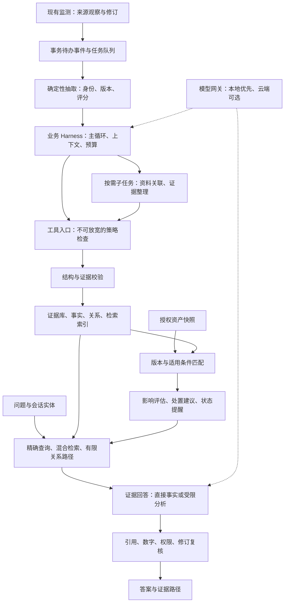

# AI 安全知识情报系统：最终架构收敛稿

检索日期：2026-10-02；讨论整合：2026-10-03。主聊天已读独立报告并发送第二轮质疑，按评审的收敛结论整合本稿。模块二、三只做设计，未实现、未测评；不把设计目标写成现有效果。

本方案承接[上一版设计](system-design-v2.md)，保留现有 Python 标准库监测模块与来源契约。本地原始赛题 PDF（未随代码再分发）不修改。团队为 2–3 人、校内提交约 15 天，系统自行部署，本地推理优先，云模型为可选后端。

## 1. 推荐结构与取舍

采用 **证据驱动的模块化单体 + 一个有界 Agent 主循环 + 按需专职子任务**。确定性工作流负责监测、事务、版本计算、权限、状态失效；模型负责语义理解、资料选择、关系候选和基于证据的说明。后台提前做好富化和资产判断，用户问答复用结果。

业务核心、工具门禁、持久任务与模型协议解耦。首版选择自建薄业务 Harness：小型持久状态机、受限模型/工具循环、注册表、上下文投影和预算；LangGraph只保留未来替换接口。不同时嵌入 DeepSeek Harness、Codex、Claude Code 和 LangGraph。借鉴其公开机制，框架选择不能代替项目验证。选择薄运行时的理由是集成复杂度和工期；比赛没有禁止LangGraph，项目“第一交付使用标准库”也不等于永远禁止未来模块使用依赖。

部署上是一个业务应用、一个后台 worker、一个可选的本地模型服务。同一设备即可承载；“多个角色”是有工具范围和输出契约的任务角色，不要求多个服务器或多个大模型常驻。

相对 v2 的收敛方向：七维富化分阶段；复杂依赖图改为事件级失效；普通问题减少模型调用；Jev 改为可插拔评测分支；编排框架不承担业务事实和数据库事务。

## 2. 比赛原文对应与真实缺口

已重读原始 PDF 全部四页。其第五条定义三大模块，额外要求同步采集论文、标准和政策；Agent 角色与架构不强制。第八条只写“学生自行部署运行”，未明确要求完全离线，也没有确认云 API 可用。AI 风险分类仅供参考、不作为评分依据。

| 原文与页码 | 设计与可检验产物 | 初赛/决赛评分关系 | 缺口与界定 |
|---|---|---|---|
| P1 第五条：多源自动监测；P2–4 时效性 | 延续增量采集、修订、去重、来源许可与失败恢复；保存发布时间和采集时间 | 初赛监测 15、时效 5；决赛监测 10、时效稳定性 5 | 五个入口不等于五类来源；当前四类来源，不能宣传七类或全网实时 |
| P1：多维扩展、深度加工；P2 初赛富化标准 | 首版五类有实际产物的富化，关联正确性单独评估 | 初赛富化 15、准确率 5；决赛富化 10、准确率与召回率 5 | 空字段、重复计数或简单照搬已有 CVSS 字段不算已验证的深加工 |
| P1：论文与分析文章 | 区分同一漏洞研究、技术背景和未证实候选；保留定位证据 | 支撑富化维度、准确率与跨文档推理 | 首版只用许可的摘要/元数据，不能推断论文正文实验细节 |
| P1：定位受影响互联网资产 | 清单中授权、声明暴露的资产与组件范围、配置条件匹配 | 支撑富化与个性化问答 | 清单不等于全网资产；是否足够覆盖原文须在作品范围里明示，不能保证得分 |
| P1：搜集可用 POC 验证代码 | 首版记录允许来源中的链接、发布者、关联依据、许可证、可用性状态 | 可展示 POC 线索维度 | 元数据不等于已搜集代码或已验证可用；当前项目禁止下载/运行 POC，不声称完整覆盖 |
| P1：CVSS 与影响评估、影响范围和修复建议 | 评分版本/vector/来源冲突校验；资产适用性和有来源的修复卡 | 富化、QA、准确率 | 缺失不是 0；不能由模型自行编造分数、修复版本或可利用结论 |
| P1：复杂意图、跨文档语义检索与关联推理 | 多轮实体、中文混合检索、限深证据关系、逐事实引用 | 初赛 QA 15、性能 5；决赛 QA 10、质量 10 | 引用存在不等于支持结论；关系路径不等于已实证攻击链 |
| P1：同步论文、标准、政策 | 来源配置增加相应官方目录/许可元数据通道；文档类型、版本、生效/更新时间独立建模 | 知识范围和完整性要求 | 当前监测并未完整覆盖标准和政策；新增来源先审核条件，不做无许可正文搬运 |
| P1/P3/P4：自主决策、编排、工具调用、恢复 | 主循环按证据缺口选择任务、工具和停止条件；输出轨迹和故障实验 | Agent 初/决赛均 15；自动化初赛 10、工程化决赛 10 | 三段固定提示词串联不能直接宣传多 Agent 自主协作；“自愈”只指可验证的重试、恢复和重算 |
| P2–4：报告、视频、PPT | Word+PDF 技术报告、核心亮点预览页、视频、PPT PDF；决赛按模板去识别信息 | 初赛文档 15；决赛文档 10、演示 10、其他 5 | 本文件是架构设计材料，尚不是完整参赛报告或实测结果 |

初赛参考：富化“至少支持 3 种”合格、“支持 5 种以上”良好；准确率 70%/85%/95%；多跳 QA 准确率至少 85% 是优秀参考。决赛参考：富化 P≥80% 且 R≥70% 为合格，均≥90%/95% 为更高档；QA 合格要求准确率≥75%且响应≤5s，更高档强调≥90%多跳、≥95%可解释推理链。初赛监测文字为“3 类以上/5 类以上/7 类以上且含实时”，按原文保留，不擅自承诺档位。

这些是评分参考，不是我们已达到的指标，也不能简单相加预测分数。

## 3. 借鉴依据：来源证明什么，迁移什么

所有资料按 2026-10-02 的公开状态查阅。下表的“收益”是本项目的工程推断，必须通过最后一列的实验验证；厂商示例效果不作为本项目准确率或性能证据。

| 公开设计与一手依据 | 来源实际证明的范围 | 本项目迁移与理由 | 代价、验证与阶段 |
|---|---|---|---|
| [DeepSeek 官方 Harness](https://www.deepseek.com/en/harness/)、[架构固定快照](https://github.com/deepseek-ai/deepseek-harness/blob/639ed015397290b3745d163aafe02ffee4aa3f84/docs/architecture.md)，2026-09-29 | 官方项目基于 Cordis；模型、工具、会话、循环可替换；Python SDK 启动 dsh 子进程 | 来源、模型、检索器、富化器采用稳定接口；避免供应商协议进入版本匹配等领域规则 | 首版借鉴接口；更换模型后同一套契约实验通过。不迁入整套预览内核 |
| [DSH 工具流水线](https://github.com/deepseek-ai/deepseek-harness/blob/639ed015397290b3745d163aafe02ffee4aa3f84/docs/tool-execution-pipeline.md)，同一固定快照 | 执行前检查、单调拒绝 guard、结果规范化与冻结、call/result 日志有公开定义 | 所有工具经过统一入口，任一强制拒绝不能被后续模型/hook推翻；模型和审计展示同一份最终结果；任何参数改写后检查实际访问目标 | 首版；攻击材料要求改权限或伪造子任务身份时，工具本体必须没有执行。结果冻结不保证内容正确 |
| [DSH SAFETY](https://github.com/deepseek-ai/deepseek-harness/blob/639ed015397290b3745d163aafe02ffee4aa3f84/SAFETY.md)，同一固定快照 | 官方提示尚未安全审计，不能视作生产级安全控制 | 可借鉴机制；本项目仍需自己验证数据、网络和权限边界 | 不用品牌代替安全证据，不以插件化宣称防住所有提示注入 |
| [Codex agent loop](https://openai.com/index/unrolling-the-codex-agent-loop/)，2026-01-23 | 模型请求工具→Harness执行→结果回到模型；上下文管理是Harness职责。文章区分产品表面与公开CLI | 保留计划、工具反馈和明确完成条件；持久状态放数据库，模型上下文按需投影 | 首版；任务必须达到证据检查和提交条件，不能靠模型说“完成”成功 |
| [Codex 长任务实验](https://developers.openai.com/blog/run-long-horizon-tasks-with-codex) | 作者展示外部状态、里程碑验收、验证失败后修复；它是编码实验 | 每条富化任务有输入快照、完成条件、阶段结果和重试状态；不用聊天摘要充当事务检查点 | 首版；进程被终止后可恢复，且旧任务不会覆盖新修订。实验的25小时/效果不迁移成我们保证 |
| [Claude Code 原理](https://code.claude.com/docs/en/how-claude-code-works)、[上下文工程](https://www.anthropic.com/engineering/effective-context-engineering-for-ai-agents)，后者2025-09-29 | Gather→Act→Verify循环；按需取上下文、压缩、笔记和子任务是公开机制 | 先给证据目录、任务约束和必要摘要，再按ID加载片段；子任务只回传结构化结果和证据ID | 首版；比较全量上下文与小证据包的正确率、输入量和完整延迟；压缩不覆盖原始证据 |
| [Anthropic 工作流与Agent](https://www.anthropic.com/engineering/building-effective-agents)，2024-12-19 | 区分固定工作流和动态Agent，路由、并行、编排、评估优化各有适用条件，建议按测量增加复杂度 | 稳定步骤由代码完成，缺资料或复杂问题才进入有界主循环；独立子任务可并行 | 首版；与固定RAG基线比较关联正确率、失败率和耗时。不能认为多角色必然更强 |
| [LangGraph Persistence](https://docs.langchain.com/oss/python/langgraph/persistence)、[Functional API](https://docs.langchain.com/oss/python/langgraph/functional-api) | 检查点和跨会话存储分开；重放涉及幂等和副作用处理 | 编排适配可替换；任务数据库与事务outbox独立保留，不能拿graph checkpoint替代业务事务 | 后续可替换；首版使用薄运行时。恢复时重复执行不重复提交 |
| [Transactional outbox](https://docs.aws.amazon.com/prescriptive-guidance/latest/cloud-design-patterns/transactional-outbox.html) | 同事务记录业务变更与待发送事件，避免双写不一致；仍需处理重复消息 | 来源修订与富化待办同事务；提交派生结果与后续任务同事务 | 首版；故障注入验证不漏任务、不重复提醒，不宣称外部请求恰好一次 |
| [OSV schema](https://ossf.github.io/osv-schema/)、[PyPA 版本规范](https://packaging.python.org/en/latest/specifications/version-specifiers/) | 生态/版本范围定义不同，包身份、aliases、related含义不同 | 生态适配器计算版本范围，模型只解释结果；先覆盖可核验的主赛题组件 | 首版；预发行、边界版本、epoch、未知版本、回移补丁案例；不写通用字符串比较 |
| [Dependency-Track 最佳实践](https://docs.dependencytrack.org/best-practices/)、[CycloneDX VEX](https://www.cyclonedx.org/capabilities/vex/) | BOM/PURL与部署组件身份、环境化受影响状态有公开定义 | 导入资产后持续重算，保留快照年龄、条件和不受影响理由 | 首版；新公告和资产升级分别触发。清单过期不能标成已修复 |
| [Jev / System One](https://docs.typesafe.ai/concepts/system-one)、[confidence](https://docs.typesafe.ai/confidence) | 提供受限选择和置信相关机制；公开描述不能证明本项目或中文判定正确 | 统一DecisionGateway，允许替换论文关联、问题路由、单条引用支持判定；仍由代码执行权限与版本规则 | 首版先本地结构化判断；原生Jev仅影子对照。格式正确、模型高置信或双模型同意均不等于事实正确 |

区别：借鉴 Codex/Claude Code 的循环、上下文和反馈，不把它们当成我们必须运行的服务；OpenAI托管Agents API、开源CLI、Agents SDK也不是同一实现或同一部署条件。

## 4. 三类状态与一个工具入口

**证据状态**：不可变来源观察/修订、上游ID、来源URL、采集时间、许可范围、定位片段；派生事实有输入修订、方法版本和适用条件。模型摘要、聊天记忆不能写回上游原始事实。

**任务状态**：任务ID、事件ID、输入代次、阶段、租约、重试时间、预算、结果与错误。恢复以数据库为准；模型只看当前阶段需要的内容。`queued → running → succeeded / retry_wait / failed` 是运行时状态，模型不能直接把任务改成成功。

**会话状态**：用户已确认的资产范围、漏洞实体、偏好、问题摘要及证据ID。续问重新读取有效事实；历史回答不是新证据。压缩只减小模型上下文，完整受限审计记录和来源事实继续存在。

工具入口接受结构化领域参数，例如 `get_event(event_id)`、`get_source_revision(observation_id, revision)`、`retrieve_evidence(query, filters)`、`match_assets(event_id, snapshot_id)`、`lookup_allowed_reference(reference_id)`。工作区身份由应用传入；模型不传任意SQL、Shell、目标URL、凭据或可改变授权的身份字段。

执行顺序：参数/schema→当前授权和来源许可→网络边界→预算→工具本体→结果大小/schema/修订/许可复核→冻结结果→记录并返给模型。公开采集入口继续阻断私网、URL凭据和不允许重定向；本地推理入口固定服务地址、协议、端口与路径，与公网采集器分开。

注册表由管理员配置，不允许外部文章指挥安装插件。强制拒绝不能被所谓“审查Agent同意”取消。工具错误返回明确错误和可用回退，不能伪装成成功的空列表。

## 5. 模块二：首版五类产物与按需扩展

| 首版产物 | 确定性处理 | 模型可承担的任务 | 有效性要求 |
|---|---|---|---|
| 组件、受影响范围及前置条件 | 包身份、生态、范围规则、来源冲突 | 从许可公告片段提出条件候选 | 版本事实可定位，身份不明或冲突保留unknown |
| 授权资产影响评估 | 版本与配置证据匹配、快照有效性 | 解释为何受影响、缺什么信息 | 输出potentially_affected/under_investigation/not_affected_with_reason/resolved，版本命中不等于已被入侵 |
| 论文与分析资料关联 | CVE/GHSA、明确缺陷或补丁定位 | 在召回候选中判断直接关联、背景相关、未知 | 同主题/同仓库不能自动成为同一漏洞证据；摘要的证明范围有限 |
| CVSS/弱点与影响加工 | 校验vector、版本、评分来源；冲突并列 | 根据来源解释影响与条件 | 不重复抄字段作为深加工；不让模型补无依据分数 |
| 修复和缓解卡 | 修复版本、适用条件、公告修订 | 归纳多文档方案和缺失证据 | 每项关键建议有来源和条件；资产升级后用新快照重算，不自动修改服务 |

POC线索作为额外、明确标记的产物；KEV/EPSS优先级后续加入。通用AI风险模式独立于CVE，记录“外部输入/RAG/工具权限/联网/写权限”等能力前提及预防、调查、恢复措施，不把每个AI风险强行绑定软件版本。

正常路径：新公告提交→读取输入代次→代码抽取结构化事实→主循环检查缺失维度→选择资料关联或修复子任务→受控工具取许可内容→角色返回候选与证据→业务校验→提交事实与索引待办→重算相关资产→更新站内状态。资料足够时可直接完成，不必让模型重复搜索。

主循环输出结构化计划，如“已有什么证据、缺什么、使用哪个允许工具、何时停止”。它能根据反馈换候选查询或停止，但不能改变来源许可、版本算法和资产授权。专职角色是可被调度的独立任务上下文，具有工具集合、结构化输出和预算，不是给同一固定流水线换几个名称。

首次导入触发全量匹配，此后新漏洞、来源修订/撤回、别名合并、规则变化和资产快照变化自动局部重算。只有一次导入无法知道后来真实升级；首版显示清单年龄，后续通过CI推送SBOM或受控只读接口刷新。匹配没有结果、来源不可用或版本未知都不等于安全。

首版版本能力矩阵优先围绕vLLM/PyPI与Ollama服务的已核实组件身份：允许精确受影响版本枚举，以及与来源声明的版本方案相符、通过边界测试的纯release数字范围子集。PyPI不能整体当SemVer；预发行、epoch/local/post/dev、Git祖先和回移补丁未经支持均unknown。Ollama服务和PyPI的ollama客户端是不同组件，不能互用版本。多个范围联合判断时，明确命中优先；否则存在任何未判范围则unknown；全部范围均可判不命中才not_in_range。枚举未命中也不能排除未解析范围。每次判断记录版本方案、支持规则、原始范围和rule_version，并统计unknown率。若主要缺口只是两段release，优先增加经测试的零填充支持；完整生态库作为后续扩展方案，不自行造一个“全生态通用比较器”。

## 6. 模块三：快速事实与受限分析

1. **精确问题**：CVE/GHSA、组件与资产ID可定位时，直接读取结构化事实、版本判断、修复卡。可用模板回答；需要自然语言归纳时一次模型调用。此路径不执行现场联网富化。
2. **语义或续问**：解析用户意图和上一轮已确认实体，组合中文关键词与向量候选；合并排序后加载少量有效证据。中文分词或字词索引必须实测，不能直接声称默认FTS5已经足够。
3. **跨文档问题**：先取得证据目录，再由主循环选择限定的关系查询或补充证据读取。首版关系表限定2–3跳，跨越前提不明或未核边时输出假设/未知。

证据包包含来源修订ID、可引用片段/结构化字段、适用条件、当前状态、时间和冲突标志。答案先形成单条结论，再映射到支持它的证据。代码检查引用存在、权限、修订、数字和版本；语义支持判定只提供辅助判断，不作为绝对正确性证明。

出处来自同一个事件但与句子无关，仍然应视为不支持。支持不足时最多一次补取/修正；达到预算后删掉无证据断言，或明确说明未知。回答中的“可解释推理链”是公开的事实、条件与关系路径，不是模型隐藏思考文本。

初始预算候选：普通问题0–1次生成；复杂任务最多4次模型请求（包含子任务与修正），子任务深度1、同时最多2个；工具调用数、证据条数、输入量和总deadline另设硬限。数值需按设备评测调整，次数有限不意味着一定≤5秒。

模型网关统一消息、工具调用、错误、超时与结构化输出；本地生成、embedding与决策后端独立配置。模型离线或性能不足时显示结构化事实/关键词结果和缺失能力，不把降级结果算作已完成语义问答。embedding模型换代先重建并核验索引再发布。

## 7. 修订与撤回：先可靠失效，再精细优化

首版用粗粒度 **事件代次** 而不是通用依赖图。新来源、新反证、来源修订/撤回或实体映射变更使相关事件的generation增加；即使新增反证未被旧答案引用，也必须重评。其旧派生事实、资产判断和问答缓存立刻不再作为当前结论使用。各来源仍单独保留：一方撤回不代表其他来源或整个CVE被撤回。

任务唯一键包含任务类型、事件ID、输入代次、方法版本。派生结果保存展开到原始观察的证据修订ID，不能只依赖上一层模型摘要。最小发布签名包含全部相关事件代次、证据修订、资产快照、entity_mapping_version、rule/method_version、当前策略版本和lease attempt。worker在短提交事务里校验签名、租约归属/attempt仍当前且未过期、任务仍running且未取消、来源许可和资产授权仍有效，只能提交仍匹配的结果；同一输入代次中，过期租约的旧worker也不能覆盖新attempt。资格检查与结果写入使用同一写事务，不能在事务外查完再无条件插入。权限变化同样触发失效，不能只查业务版本。过时任务保留轨迹、丢弃提交并确保最新任务存在。method_version覆盖实际模型/提示/抽取方案/工具契约的组合，具体版本另作复现记录；后端不公开精确版本时明确限制。租约恢复采用至少一次处理，事实提交、任务完成与后续任务同事务，不能依赖“模型这次应该只执行一次”。

来源变更、失效标记和outbox写入同事务。现有监测未被修改；后续实现须按来源变化契约新增这一连接，并有迁移和故障验证。当前监测的规范事件合并没有自动错误拆分接口，不能宣称已有可撤销合并。富化层拟增加基于观察/修订ID的实体映射投影，读取各观察最新revision中的aliases及其声明来源，不直接把监测的合并组或残留canonical_aliases当业务等价真相。桥接别名被撤销或出现冲突时，先使整个受影响组待核、阻断跨实体派生；人工确认记录证据、理由、操作者与时间后，同事务更新映射版本、失效状态和重算待办，再重建发布。原观察ID和历史证据保持可定位；无撤销信号或有歧义时保持待核。自动可信拆分暂缓，且普通来源修订无需逐条人工审批。

首版证据、映射、代次、任务、业务结果和待办继续放在同一SQLite数据库，不为插件层另建一份业务真相数据库。跨库实现不能直接沿用“同事务原子发布”的保证；需要另行设计一致性协议。

FTS与结构化事实尽量同事务更新；向量索引是可重建派生物。检索命中仍须回查数据库的来源/事实代次与状态，旧向量不能使撤回事实复活；不足时补取有效候选或退回当前事实。全局knowledge_epoch用于缓存失效和问答快照检测，不是提交正确性的唯一条件。

答案记录知识epoch、资产snapshot、模型/规则版本和证据修订。最终输出前以短读事务核对全部相关事件与引用状态，给出as_of快照；并发变更时有界重检或返回“资料正在更新”及已核实事实。这只能保证核验快照的一致性，不能阻止核验后立即出现新资料。检测到新代次后，旧答案标记待重评；epoch变化不直接代表旧答案错误，只有新证据确实推翻才标记已更正。断连客户端显示最后同步时间。历史答案保留“当时使用什么”，重新打开或续问重新判断。不在最终核验前流式展示确定影响结论。

### 一个完整失败场景

公告A曾称某版本受影响，资产X被标记potentially_affected，答案引用A-r1。后来A-r2撤回该范围：采集提交A-r2，同时事件代次增加、旧事实和影响判断失效、outbox排队；引用r1的缓存失效；正在跑的r1任务提交时被代次检查拒绝；检索即使召回r1的向量也被过滤。worker基于r2及其他有效来源重算，更新X状态并解释变化依据。若其他来源B仍认为受影响，则保留冲突、进入待核，不能直接宣布安全。旧回答标记已被新证据修订，当前问题返回新评估。

代价是同一事件中的无关结果也会重算，全局缓存可能失效较多。首版规模小，先验证安全纠错；队列积压和重算成本成为瓶颈后，再增量改为精细依赖图。

## 8. 安全风险：预防与事后纠正进入同一闭环

以下是系统设计控制与处置建议，不是“每一种风险均可避免”的保证。资产能力不足或没有配置证据时，只能说明风险前提和调查步骤。

| 风险/失败 | 预防机制 | 发生后的纠正 |
|---|---|---|
| 来源提示注入、伪造管理员或子Agent命令 | 材料与系统指令分离；运行时身份、固定工具和不可放宽门禁 | 停止该任务，隔离来源修订，失效其派生结果，审计实际调用后用可信来源重算 |
| 知识库投毒、错误或撤回公告 | 许可来源、独立来源保留、关系候选与事实分开、代次检查 | 修订/撤回触发纠错；保留来源冲突、历史证据与受影响答案列表 |
| 幻觉、错误引用、错误版本判断 | 版本规则与数字用代码；逐结论证据；未知状态；独立标注集 | 撤回不支持结论，重检证据；修正规则后重算；失败样本进入冻结回归集 |
| SSRF、恶意链接、间接外发 | 受控来源ID、DNS/重定向/私网边界；本地推理独立入口 | 禁用相关来源/适配器，核对实际请求与外发范围，修复边界后恢复 |
| 敏感资产信息、日志和模型输入泄漏 | 最小输入、云端默认不发内部地址/配置、日志不记录密钥、权限检查 | 停止外发和受影响访问；由资产负责人轮换已暴露凭据；重查受影响导出与任务 |
| 供应链或框架漏洞 | 只启用审核实现、锁定版本、清单可追踪；工具无动态安装能力 | 禁用受影响适配器、更新组件；按官方建议和实际快照重新评估 |
| 模型不可用、429、超时、异常响应 | 全链路预算、Retry-After、退避、响应大小与schema限制 | 延后重试/失败队列、事实查询降级、恢复后继续任务；不丢游标或标假成功 |
| 资产已升级但清单过期、自动处置误操作 | 快照时间与缺失条件可见；首版只给建议，不修改目标服务 | 新快照重算，保留修复验证依据；未获得新证据前不标记resolved |

Jev与审查模型适合辅助关联/支持判定；权限、来源许可、网络边界和事务必须由确定性代码执行。两个模型可能共享错误，评审通过不能提升来源材料的授权等级。

DecisionGateway与生成模型网关分开，本地LLM实现结构化选择协议不等于原生Jev本地部署。当前核验的[Jev官方模型文档](https://docs.typesafe.ai/models)给出托管API及版本ID，且提示中文等CJK效果需自行测试；本方案没有核验可自托管的公开权重，不把它作为本地首版前提。若后续使用，固定版本，对每种题类评估误放行、弃权、覆盖、校准和完整耗时；官方校准描述不保证单个判定正确。

## 9. 验收：证明改进，而不是证明用了热门架构

先冻结人工标注的证据快照和测试集，按漏洞事件拆分开发/留出集，避免同一CVE的改写题泄漏。保留基础版“结构化查询+固定RAG”作对照，再测“按需主循环”，最后才加语义审查/Jev；分别报告增益、延迟、模型调用与错误类型。

评审最小集建议20个漏洞事件、20个资产快照案例、至少40组正负资料候选、60道分组问答，另有独立注入/撤回/并发故障集；有余力扩展到v2的50事件/80候选/100题。公布实际样本数、分子分母和不确定性；小样本不足以稳定证明95%档位。QA分为基础、多轮、多跳、未知/冲突、安全题；不能只展示挑选出来的成功例。

规则的“准确率”未定义统计单位，不能直接把它替换为precision。报告分别列总体正确率、precision、recall、未知率及覆盖率，说明事件/断言/关联/资产判断各自分母。论文关联不能只评命中的候选，否则会漏掉召回分母。

| 检验 | 需要证明的性质 |
|---|---|
| 版本与身份 | 范围边界、预发行、版本未知、相似名称、回移补丁不会被简单误判 |
| 富化关联 | 逐维precision/recall、未知/弃权率、覆盖率；全弃权不能换取虚高准确率 |
| 问答与引用 | 答案正确、每条关键事实得到引用支持、多轮实体正确、多跳每一步有证据 |
| 更新与恢复 | 强制终止、重复任务、事务故障、撤回和别名合并后，无漏任务、无旧结果覆盖、无重复提醒 |
| 安全边界 | 注入、伪造身份、私网URL、越权资产、危险输出和敏感外发请求不执行；页面内容转义 |
| 本地性能 | 记录设备、模型/量化、上下文规模、冷/热启动、1/3并发；完整答案P50/P95、超时率，TTFT另报 |
| 自主编排增益 | 固定计划与动态缺口计划对照，是否改善召回/正确率、是否增加无效搜索或耗时 |

P95≤5s是工程目标，规则没有明确统计口径；最终报告同时给整体和各题型的完整耗时，不用快速事实题平均掩盖深度问答慢，也不拿首token当完整响应。任何当前未测的指标只列目标，不写达到。

## 10. 约15天实施顺序

| 时间 | 主要交付与完成条件 |
|---|---|
| D1–2 | 固定事实/资产/任务/工具契约；冻结评测快照；实测可用本地模型；补齐标准政策来源计划；敲定唯一编排运行时 |
| D3–5 | 结构化富化、版本判断、资产初始及增量匹配；覆盖边界/未知案例 |
| D6–7 | 论文/文章关联、修复卡、事件级失效与撤回重算；主循环能按缺口调用专职任务 |
| D8–10 | 精确问答、中文混合检索、续问与有限多跳；逐事实引用和快照复核 |
| D11–12 | 故障/安全/性能评测，删减无增益调用；评测不过的能力按范围降级并如实展示 |
| D13–15 | 技术报告、图、视频、PPT PDF和演练；冻结演示快照、备好模型不可用时的事实展示 |

三人分工：A负责数据/任务/版本/资产；B负责检索/模型/问答；C负责页面/证据审计/评测与材料。两人时合并C，减少额外POC/态势接入；主聊天统筹接口和最终验证。模块二、三实施须进入用户授权的后续阶段，本轮不安装依赖或更改实现。

## 11. 评审记录与待收敛项

独立评审对话：`AI 安全情报系统最终架构评审`，GPT-6.1 sol、Ultra，同工作区。[提示词](handoffs/architecture-review-prompt.md)，[独立报告与第二轮记录](handoffs/architecture-peer-review.md)。两轮讨论先独立挑战v2，再由主聊天发送具体选择与反例，独立评审补查并修订报告。

| 讨论分歧 | 收敛决议与理由 |
|---|---|
| LangGraph是否为首版必需 | 薄业务Harness为首版，保留替换接口；范围和复杂度决定，比赛没有禁止框架。自建也须验证恢复和实际自主性 |
| 通用七维/研究群与本地延迟 | 先五类真实产物、按需窄子任务、预计算与快速事实路径；完整研究群和多轮裁判须先证明增益 |
| 裸epoch是否足够纠错 | 不足。新增反证、最小原始依赖签名、同事务发布资格、租约attempt和查询核验均保留；精细DAG后续 |
| 错误别名如何恢复 | 确认监测无自动拆分接口；富化投影隔离与人工重建，观察ID不变。当前合并桶不作为业务等价保证 |
| 答案能否一直最新 | 只保证as_of快照；新epoch触发待重评，明确推翻后更正；客户端最后同步时间可见 |
| 版本能力与unknown过多 | 优先两类赛题目标、有限且测试过的规则；统计覆盖/unknown，多范围不能漏判；不按计分需求猜测复杂版本 |
| POC与互联网资产是否已覆盖 | 明示两个范围缺口；没有运行代码、扫描或扩权来填补评分。是否认可须赛事解释，不自行保证 |

仍待项目实验或赛事解释的事项：本地中文模型/检索/完整延迟、实际富化与QA质量、有限版本覆盖、Agent框架计分解释、云API条件和两项范围缺口。讨论收敛只冻结设计选择，不能代替这些验证。

本地原始赛题 PDF（未随代码再分发）SHA256：`37f28bc38db91ec0407551b1254c8bc882432a8488ce896c681e1210814c6cf3`。保留原件；本稿只新增设计文档，没有实现模块二、三或运行服务。
