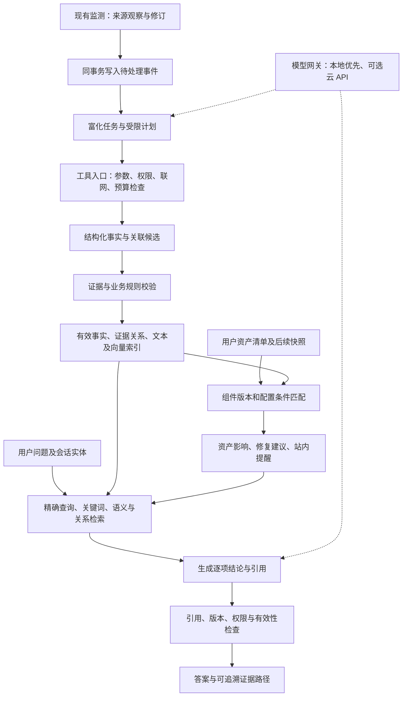
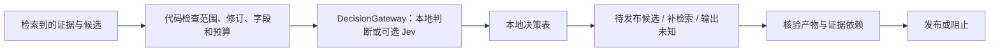

# 第二、第三模块优化设计：情报富化与证据问答

研究日期：2026-10-01；Jev 决策层增补：2026-10-02。状态：架构提案，第二、第三模块尚未实现或测评。本轮只维护设计文档，不安装依赖、不启动服务、不执行扫描或 POC。

## 1. 设计结论与规则核对

建议采用 **证据与资产为中心的模块化单体 + 有界 Agent 工作流 + 混合检索 + 有来源的关系表**。保留现有监测模块的标准库实现、来源观察记录、修订历史和事务边界。第二模块把材料加工成可核验的事实与资产判断，第三模块查询这些事实并解释证据路径。

本地部署系统与本地模型推理是两个独立选择。规则第八条要求学生自行部署运行，四页文件没有明确要求完全离线，也没有指定模型供应商；这不等于主办方已经确认允许云 API。设计以本地推理为基础，预留经显式配置启用的云后端；最终使用方式以赛事后续说明为准。

| 规则要求 | 本方案的对应设计 | 如何验证 |
|---|---|---|
| 富化包括论文/文章、互联网资产、POC、CVSS 等，且“包括但不限于” | 七个独立维度；明确缺失字段和覆盖范围 | 每维有效产物、证据覆盖率、关联准确率 |
| 初赛至少三维合格，五维以上良好，准确且含自动关联推理优秀 | 优先落实组件范围、资产影响、关联资料、POC 元数据、评分影响、修复、利用态势 | 不把空字段或同一字段拆分计作多个完成维度 |
| 初赛富化准确率 70% / 85% / 95%；决赛增加召回率 | 固定证据快照、人工标注、分维度评估 | 决赛参考门槛为 P≥80% 且 R≥70%、均≥90%、均≥95% |
| 初赛语义、多轮、跨文档推理；多跳准确率≥85% 为优秀参考 | 问题路由、会话实体、混合检索、有证据的关系路径 | 基础题、多轮题、多跳题分开报告 |
| 决赛问答合格：准确率≥75% 且响应≤5秒；更高档强调多跳与解释 | 精确查询快速路径、预计算、少量模型调用、逐事实引用 | 记录完整答案耗时；P95≤5秒是本方案的工程目标，并非规则指定的统计口径 |
| Agent 自主决策、编排、工具调用；全流程自动化与恢复 | 受限计划、角色节点、持久任务、检查点、幂等与退避 | 可回放轨迹、断点恢复、违规调用拒绝、更新后重算 |

以上是目标与设计对应关系，不能据此声称已经达到分数或准确率。风险分类在规则中仅供参考，并非评分依据。

规则来源：工作区原始《9 赛题九：网信产业应用赛道-智能体驱动的AI安全知识情报系统设计与实现（奇安信科技集团股份有限公司）》第1–4页；原文件保持不变。

## 2. 系统结构与关键设计模式



首版采用一个业务应用、一个后台任务 worker、一个可替换的本地推理服务。它们可以在同一台设备运行；多角色 Agent 是工作流中的职责划分，无需拆成多个服务器。

- **模块化单体与接口适配**：组件身份、版本规则、证据校验为普通 Python 领域函数；工作流、模型、检索、外部 API 是适配层。以后更换模型或数据库不重写业务规则。
- **事务待办事件（transactional outbox）**：来源修订与待处理任务同事务提交，避免“采集成功但富化触发丢失”。任务租约、重试与唯一键使重复交付不重复生成结果；不声称外部 API 恰好调用一次。[模式依据](https://docs.aws.amazon.com/prescriptive-guidance/latest/cloud-design-patterns/transactional-outbox.html)
- **受控状态机**：流程顺序、允许工具、回退次数和预算由代码定义，Agent 在范围内选择补充哪些资料、如何拆解问题。LangGraph 官方区分固定工作流与动态 Agent，支持路由、并行和编排。[官方工作流](https://docs.langchain.com/oss/python/langgraph/workflows-agents)
- **来源事实与派生结果分开**：富化结论、模型摘要、用户资产评估独立存储，不覆盖监测原始观察；每个派生结果保留依赖证据及方法版本。
- **小型显式关系图**：首版用 SQLite 关系表实现限定深度的查询，不要求图数据库。图只是检索方式，每条有效边都必须有证据。

建议后续增量引入 LangGraph 和结构化输出校验库；现有监测包不依赖它们。先沿用现有 Web 入口和 SQLite WAL；确有接口需求再引入 FastAPI，不为框架迁移消耗工期。向量检索设计成接口，小规模可用本地向量文件/表和内存相似度计算，扩大后再评测专用向量库与 PostgreSQL。依赖选型仍属提案，本轮没有安装。

## 3. 第二模块：有证据的情报富化

### 3.1 七个主要维度

| 维度 | 自动化方法 | 可用产物 | 必须保留的边界 |
|---|---|---|---|
| ① 受影响组件与版本 | 读取公告和 OSV 的生态、包身份、版本范围、修复版本、前置条件 | 组件—漏洞范围事实、缺失条件 | 软件产品、Python 包、仓库不是同一身份；不按名称相似直接合并 |
| ② 资产影响范围 | 与用户授权清单匹配，再检查暴露面、鉴权及相关配置 | 影响资产、判断理由、调查任务 | 版本受影响不等于已确认可利用；快照过期必须提示 |
| ③ 论文与分析文章 | 明确 CVE/GHSA 或可核验的缺陷/补丁定位优先；仓库、关键词和语义召回补充 | 直接研究资料、技术背景资料、待核关联 | 仅引用同一仓库或相似主题不能证明同一漏洞；摘要不能支撑正文实验细节 |
| ④ POC 与补丁线索 | 从公告 references 和允许的官方元数据源发现、分类 | URL、发布者、关联 ID、时间、引用修订、可用性确认依据 | 只保存元数据和链接；未验证链接不叫“有效 POC”；不下载、不运行 |
| ⑤ CVSS、弱点与影响 | 保留发布方 CVSS 版本、vector、评分、CWE；提取影响条件 | 多来源评分、机密性/完整性/可用性影响 | 不由模型编造分数；来源冲突并列；缺失不是 0 |
| ⑥ 修复与缓解 | 关联厂商公告的修复版本、补丁、临时措施及适用前提 | 每个资产的修复建议和缺失信息 | 建议须有来源；不能把通用建议说成官方补丁；本系统不自动修改目标服务 |
| ⑦ 利用态势与优先级 | CISA KEV、带日期的 EPSS、资产暴露及业务重要性 | 分级处置队列与触发因素 | KEV 是已知在野利用，EPSS 不是本机被入侵概率；不机械乘 CVSS 与 EPSS |

补充维护 AI 风险模式表，将提示注入、RAG 投毒、工具权限滥用等与 MITRE ATLAS 技术、前提、措施联系起来。它与有 CVE 的软件漏洞分开建模：没有 CVE 不代表没有 AI 风险，通用模型风险也不能硬套软件版本范围。

首版论文只使用经允许的元数据和摘要，不下载论文 PDF。文章正文或片段仅在具体来源许可范围内使用；无法取得允许的内容时只保留元数据和链接。

组件身份与持续匹配借鉴 [Dependency-Track](https://github.com/DependencyTrack/dependency-track) 的 SBOM 思路，其官方建议 CI 生成 BOM、使用有效 PURL；我们借鉴数据关系，不部署完整供应链平台。[最佳实践](https://docs.dependencytrack.org/best-practices/)

[OSV schema](https://ossf.github.io/osv-schema/) 分开定义 GIT、SEMVER、ECOSYSTEM 范围，以及 aliases、related、upstream 关系。因此应使用生态适配器和经过验证的版本规则；PyPI 不能一律按 SemVer 或字符串排序。[PyPA 版本规范](https://packaging.python.org/en/latest/specifications/version-specifiers/)

CVSS 版本、来源和原始 vector 必须一起保存。[CVSS v4 规范](https://www.first.org/cvss/v4.0/specification-document)；EPSS 的日期、概率和分位数分别保存，其用途及局限见 [FIRST 官方 FAQ](https://www.first.org/epss/faq.html)。KEV 可以采用 CISA 自己维护的 [官方 GitHub 数据源](https://github.com/cisagov/kev-data)，记录使用条件和上游修订。

### 3.2 导入一次后，怎样持续自动判断

首版接收 CSV/JSON，随后支持 CycloneDX SBOM。最低字段是资产 ID、组件生态/名称或 PURL、已安装版本、清单时间；暴露面、鉴权、重要性等字段允许填“未知”。另设能力配置：是否读取外部文档、使用 RAG、可调用工具、可联网、拥有写权限，用于评估没有 CVE 的 AI 风险模式。

导入成功即做全量初始匹配，此后由以下事件自动触发局部重算：新漏洞、公告修订/撤回、别名合并、KEV/EPSS 更新、资产快照变化、规则版本变化。站内提醒仅在新影响、优先级变化、撤回或修复状态变化时更新，重试不重复提醒。

**系统持续检查的是当前清单。** 只导入一次无法自动知道用户后来升级、回滚或新增服务。首版展示快照年龄和过期提示；后续由 CI/CD 推送 SBOM、受控文件更新或只读资产连接器刷新。导入动作不授权主动扫描和漏洞利用。

互联网资产首版限定为用户明确授权、清单中声明暴露的资产。若评委希望看到全网暴露态势，需要额外接入许可的被动搜索 API 或授权数据，并注明覆盖范围和推测程度。不能把本地清单称为全网测绘，也不能把被动搜索无结果解释成安全。

匹配分两个层次：

1. `version_match = affected / not_in_range / unknown`：依据明确组件身份、版本及来源范围判断。
2. `assessment = potentially_affected / not_affected_with_reason / under_investigation / resolved`：结合前置条件、配置证据、快照有效性和修复事实判断。

回移补丁、预发行、提交版本、版本不明及来源冲突进入待核状态。`not_in_range` 只说明未落在这条已知公告范围内，不能输出“该服务没有 AI 风险”。影响状态可借鉴 [CycloneDX VEX](https://www.cyclonedx.org/capabilities/vex/) 的环境化分析，`not_affected` 必须有具体理由。

OSV 可作为公开组件的版本事实补充。其 [querybatch](https://google.github.io/osv.dev/post-v1-querybatch/) 返回 ID 和 modified，需按 ID 获取详情，并分别完成各查询的分页。外发仅含必要的公开包名/版本，默认不发送内部资产名、地址及配置；严格离线模式使用本地同步的漏洞事实。OSV 没有命中不等于不存在漏洞。

OSV 官方说明 `version` 查询可能对上游版本作模糊匹配；API 命中仍要核对精确组件身份、实际版本和范围事实，不能直接认定已确认可利用。[单项查询说明](https://google.github.io/osv.dev/post-v1-query/)

现有监测 HTTP 接口只有 GET；后续接入 OSV 的 JSON POST 时应扩展受控传输适配器，复用请求、载荷、时间、DNS、重定向和限速边界，不能旁路调用一个无限制客户端。公开资料采集与本地推理连接使用两个独立入口，详见安全设计。

### 3.3 富化工作流与 Agent 自主性

```text
新来源修订 → 定义任务输入快照 → 确定性抽取
    → 计划节点检查缺失维度与证据质量
    → 在来源/工具/调用预算内选择补充任务
    → 并行获取允许的结构化信息及资料元数据
    → 分析节点提出事实和关系候选
    → 身份、版本、证据与来源状态校验
    → 提交有效结果与索引任务 → 重算受影响资产
```

大模型适合资料分类、条件整理、中英文对齐和关系候选提出。它不能创建来源权限、决定自己的联网范围、直接合并事件、确定版本是否命中、编造 CVSS，或将未经核验的候选提升为已确认关系。

关联分三档：明确标识和引用支撑的直接关联；有依据的技术背景关联；尚待确认的候选。正式影响判断只依赖适用的有效事实。来源质量按具体断言判断，例如版本范围优先核对厂商/维护方公告，利用态势核对 KEV；不能给所有“官方文本”赋予无条件可信。

## 4. 第三模块：资产感知、证据约束的问答

### 4.1 问答流程

```text
授权与会话实体 → 问题路由/必要时有限拆解
    → 精确事实查询 + 关键词检索 + 语义检索
    → 受限关系扩展 → 证据包
    → 生成结构化结论与逐项引用
    → 确定性检查 + 必要时补检索一次
    → 输出答案，或明确缺失信息
```

| 问题类型 | 主要查询方式 | 回答要点 |
|---|---|---|
| “某 CVE 的修复版本？” | CVE/GHSA 精确查事实与修订 | 版本、来源、条件、截至时间 |
| “我的哪些服务受影响？” | 本地资产评估表，参数化查询 | 完整匹配范围、未知资产、清单时间；数量由程序计算 |
| “这类提示注入有什么研究？” | 中英文语义与关键词混合检索 | 技术背景与直接漏洞研究分开 |
| “为什么先修这个服务？” | 资产→组件→公告→态势/措施的关系路径 | 对应事实、触发条件、缺失条件 |
| “两个漏洞能形成攻击链吗？” | 预定义关系和前置条件检查 | 条件兼容才提出有依据的候选链；证据不足返回不能确认 |
| “那它应该怎么修？” | 当前会话明确选中的实体 + 同样检索 | 对象有歧义时澄清，历史模型答案不当作来源证据 |

CVE、GHSA、包名和版本走精确查询；文字问题走关键词与语义。采用 RRF 合并检索排名，学习 [LlamaIndex 官方示例](https://developers.llamaindex.ai/python/framework/integrations/retrievers/reciprocal_rerank_fusion/)，无需引入第二套编排框架。每路候选20条、最后证据6–10条只是初始调参范围，必须用评测调整。

默认只扩展2–3条关系边，并限制节点数和证据量；较长资产链先由组件关系完成确定性连接，再对漏洞关系扩展。所有关系均需引用修订。两个漏洞有相同 CWE、相同组件或相似向量，不能证明可以串联利用。

SQLite FTS5 支持全文检索，但默认 tokenizer 不能自动解决中文切词。显式设计中文分词/字粒度索引、英文组件别名与 CVE 精确项，并对短词测试。[FTS5 官方文档](https://sqlite.org/fts5.html)

检索前应用用户/租户范围、来源有效性和时间过滤；返回前再次核验，避免后台更新期间引用已失效事实。可见索引代次只在构建完成后切换，未准备好的索引不得混入当前证据包。

### 4.2 回答与解释

每条重要断言保存 `claim → fact → observation/revision/locator`，页面可打开引用原文片段及原始来源链接。结论中的版本、数字、资产数量等用来源字段或规则计算结果核对；引用必须属于本次授权证据集合。

解释展示可核验的证据路径，不要求公开模型隐藏思维链。例如下面是流程示例，不是针对真实漏洞的确认结果：

```text
资产快照 A 中组件版本 v
  + 来源公告 R 的受影响范围及配置前提
  + 规则匹配结果（包括缺失条件）
  + 官方修复公告 F
  → 对资产 A 的影响判断和修复建议
```

引用 ID 存在不等于引用支持结论。事实性判断还要对照结构化字段、证据片段和人工测评；辅助核查模型也可能犯错，不能独自批准结论。校验失败最多补检索/改写一次，再降为明确未知，避免无限循环。

来源冲突并列显示发布者、更新时间和具体差异；不按数量投票，因为多个来源可能转述同一公告。论文摘要只支撑摘要中出现的事实。回答注明知识截止时间和资产清单时间。

会话保存经校验的实体引用、过滤条件及必要摘要，按用户/租户隔离；外部材料不写成永久偏好、身份或权限。缓存键包括权限版本、会话实体、资产快照、知识代次、模型和规则版本；首版用全局知识代次失效，之后再优化细粒度失效。

## 5. GitHub 项目与模式的具体取舍

| 原始项目/资料 | 我们借鉴什么 | 首版选择 |
|---|---|---|
| [Dependency-Track](https://github.com/DependencyTrack/dependency-track)、[OSV-Scanner](https://github.com/google/osv-scanner) | 组件身份、SBOM、版本匹配、持续重算 | 借鉴领域模型，通过结构化事实接入 |
| [LangGraph](https://github.com/langchain-ai/langgraph) | 路由、并行子任务、检查点、多轮状态 | 唯一主要 Agent 编排框架；领域函数不绑定框架 |
| [Microsoft GraphRAG](https://github.com/microsoft/graphrag) | 实体邻域与文档共同检索 | 学习 Local Search；全库社区报告暂缓 |
| [LightRAG](https://github.com/HKUDS/LightRAG) | 图与向量混合、引用、删除后关系重建 | 后续对照实验候选，先验证修订/撤回/权限适配 |
| [PyRIT](https://github.com/microsoft/PyRIT) | 单轮/多轮攻击评估、回放和对照 | 借鉴测试方式，先建立小规模离线安全集 |
| [NeMo Guardrails](https://github.com/NVIDIA-NeMo/Guardrails) | 输入、检索和输出的辅助检查 | 有需要再引入，不作为授权或联网边界 |

GraphRAG 官方说明 Local Search 结合实体关系与文本，Global Search 通过社区报告做 map-reduce 且资源消耗较大。[官方查询说明](https://microsoft.github.io/graphrag/query/overview/)。据此，本项目早期以资产和具体漏洞问题为主，选择小型证据关系表更适合工期；这是项目取舍，不是对完整 GraphRAG 的普遍否定。

LangGraph 检查点用于工作流恢复；业务落库仍需唯一键和事务。重启可能重执行未完成任务，不能用框架持久化替代幂等。[检查点文档](https://docs.langchain.com/oss/python/langgraph/checkpointers)、[Functional API](https://docs.langchain.com/oss/python/langgraph/functional-api)

## 6. 本地优先与可选云模型

设计薄的 `ModelGateway`：`generate_json(messages, schema, budget)`、`embed(texts, profile)`、`health_and_capabilities()`。生成与 embedding 后端独立配置。

首版优先评测 Ollama 本地接入，保留 vLLM 适配接口；不同时部署两套推理系统。Ollama 支持 JSON Schema 输出，但返回后仍需业务校验。[官方结构化输出](https://docs.ollama.com/capabilities/structured-outputs)；vLLM 提供兼容服务接口，具体模型需要适合的聊天模板和能力配置。[官方服务文档](https://docs.vllm.ai/en/latest/serving/online_serving/openai_compatible_server/)

模型规模、量化方式、上下文与并发待实际设备测试后确定。目前没有硬件依据，不能承诺某个模型能在五秒内完成多跳答案。云端供应商也需逐一核验结构化输出、工具调用和数据使用条件，不能只修改 base URL 就假设功能等价。

embedding 索引记录模型、版本、维度、归一化和预处理；查询与建库使用同一空间。更换生成模型通常不需要重建索引，更换 embedding 模型需要重建并完整切换。[Ollama embedding 文档](https://docs.ollama.com/capabilities/embeddings)

| 运行模式/故障 | 系统行为与页面标识 |
|---|---|
| 本地系统 + 本地生成/embedding | 资产、证据、索引、推理保留在本地；采集公开情报仍需要外网 |
| 显式启用云生成 API | 仅发送裁剪后的授权证据和必要上下文，资产匹配留在本地；显示实际模型后端 |
| 严格离线 | 禁用外部推理、在线 embedding 和情报采集；使用预先准备的模型及合法知识快照，显示数据截止时间 |
| 生成模型不可用 | 返回事实、规则匹配和证据卡片，标识“未执行生成问答” |
| embedding 不可用 | 精确/关键词检索继续，标识语义检索不可用 |
| 云模型失败且已配置本地后备 | 切换本地模型并记录；不能切换 embedding 而继续复用不兼容索引 |

离线回放、缓存答案、模拟数据分别明确标识；不能以回放证明实时模型响应或现场多跳准确率。本地推理服务仅监听受控本机/容器网络，不暴露公网；服务凭据由网关持有，不进入模型上下文。

## 7. 数据契约、任务与纠错

现有 `docs/monitor-contract.md` 保持监测入口的语义。未来新增对象如下，字段为设计草案：

| 对象 | 关键字段 |
|---|---|
| AssetSnapshot | asset_id、snapshot_id、components、context、snapshot_at、freshness、scope |
| EnrichmentJob | observation_id、input_revision、dimension、method_version、state、attempts、lease_until、next_retry_at、idempotency_key |
| DerivedFact | fact_id、subject、predicate、value、evidence_refs、method、method_version、status、valid_time、created_at、supersedes |
| EvidenceEdge | subject、relation、object、evidence_refs、status、validity、method_version |
| AssetAssessment | asset_id、snapshot_id、vulnerability_id、input_facts、version_match、assessment、priority、reasons、missing_conditions |
| EvidenceChunk | observation_id、revision_id、chunk_id、source_url、locator、content_hash、scope、effective_at、withdrawn |
| AnswerClaim | answer_id、claim_id、text、fact_ids、evidence_refs、status、knowledge_epoch、asset_snapshot |

`evidence_refs` 引用不可变来源观察、修订和 JSON 字段/文本范围。模型推断、官方结构化事实、确定性规则与人工确认分开标记；模型自报置信度不作为准确率。CVE 别名合并后仍保留稳定的来源观察 ID，避免丢失证据依赖。

幂等键包含输入修订、富化维度和方法版本；租约到期可重新领取，失败按来源退避并进入可见的失败队列。外部请求有请求数、分页、载荷、时间与速率上限，失败不能把检查进度推进到未完成结果之后。

新结果只在输入版本仍适用时发布；旧任务晚到不能覆盖新版。事实提交与索引待办同事务，构建完成后发布知识代次。推理前后校验当前有效状态，更新处理中显示待重新评估而不是返回旧的确定结论。

更新或撤回的纠错路径：

```text
来源修订/撤回 → 找到依赖该修订的事实与关系
    → 使旧派生结果、索引引用、缓存答案失效
    → 从仍有效的来源重算
    → 重评资产，更新站内提醒和历史答案状态
```

一个来源撤回不意味着整个漏洞事件消失；其他有效证据可能仍支持部分结论。历史记录保留审计状态，当前答案仅引用仍适用的证据。回答更正由站内状态与证据版本体现；外部邮件/消息发送不在本方案自动权限内。

## 8. AI 安全：预防与发生后的纠正

采用 OWASP LLM Top 10 2025、Agentic Top 10 2026 和 MITRE ATLAS 建立风险测试分类。[LLM 官方分类](https://genai.owasp.org/llm-top-10/)、[Agentic 官方说明](https://genai.owasp.org/2025/12/09/owasp-top-10-for-agentic-applications-the-benchmark-for-agentic-security-in-the-age-of-autonomous-ai/)、[ATLAS 官方数据](https://github.com/mitre-atlas/atlas-data)

共同原则：模型只提出计划、候选事实和答案。代码负责身份、工具权限、资产范围、网络、预算、存储与渲染。系统提示词不是授权控制，秘密不能放在系统提示中。[OWASP LLM07](https://genai.owasp.org/llmrisk/llm072025-system-prompt-leakage/)。NeMo Guardrails 官方也明确其不提供内置认证、授权、TLS 和限流等控制。[官方安全说明](https://github.com/NVIDIA-NeMo/Guardrails/blob/develop/SECURITY.md)

| 风险 | 预防措施 | 发生后的纠正 |
|---|---|---|
| 公告、论文、RAG、工具内容提示注入/目标劫持 | 外部内容始终标记数据；读取资料节点无执行权限；固定工具和参数；辅助检测不决定授权 | 隔离来源修订/会话；撤销受污染派生结论；从有效证据重跑 |
| 敏感信息及系统提示泄露 | 密钥仅在网关持有；最小外发字段；不把完整资产清单交给模型；禁自动远程图片等输出请求 | 轮换实际泄露凭据；审查外发；清除相关上下文/缓存，保留脱敏审计 |
| 知识、记忆、模型投毒 | 来源注册、哈希、修订、隔离；不自动写入永久偏好；首版不拿实时材料微调 | 回滚来源/记忆；重建受影响索引；使依赖答案失效 |
| POC、模型、依赖、工具供应链 | 不下载/执行 POC；固定及审查依赖/模型来源；不从网页自动安装工具、技能或远程代码 | 停用组件、撤销令牌、切换可靠版本；检查关联任务与数据 |
| 过度代理、SSRF、越权 | 服务端身份和资产范围；固定工具；公网出站检查；禁止任意 URL/SQL/Shell/文件路径 | 暂停工具、撤销任务能力；审计访问并修正规则 |
| 向量、会话、缓存跨权限串漏 | 检索前限定范围，返回再核验；缓存含权限/知识版本；公共与私有资料分开 | 缓存失效、权限版本更新；定位受影响会话并重生成 |
| 幻觉、假引用、错误安全结论 | 每项证据引用；结构化版本/数量校验；冲突并列；缺失为未知 | 保留旧答案与更正原因；重算依赖事实、资产和提醒 |
| 不当输出处理 | 严格输出 schema、参数化 SQL、安全文本渲染；不 eval、执行命令或原样插 HTML | 关闭错误路径，修复后回放恶意样例 |
| 资源消耗、循环、拒绝服务 | 整个任务限制模型/工具次数、长度、并发、总时长和费用；重复计划终止 | 取消、熔断、保留检查点；收紧预算后恢复 |
| Agent 通信伪造、级联错误、盲目信任 | 服务端生成任务身份；子任务权限只能缩小；消息绑定证据；核查模型不能扩大权限 | 撤销任务链、隔离输出；从可信快照重新执行 |

工具入口只提供如 `lookup_vulnerability(id)`、`get_evidence(ids)`、`find_related_materials(component, technique)`、`match_inventory(asset_ids, vulnerability_ids)`、`get_poc_metadata(evidence_id)`。认证身份和租户从服务端会话取得，不允许模型在参数中覆盖。未知工具、未知字段和越界资源均拒绝。

公开资料采集沿用监测模块的公网 URL、DNS 固定解析、重定向与来源域名边界。本地模型采用管理员明确配置的固定协议、主机、端口及 API 路径，不跟随重定向；模型及外部材料不能提交地址。仅该推理入口允许明确配置的本机/容器目标，公开资料入口仍拒绝私网；这一入口不能用于读取任意内网服务。严格离线模式还需禁止本地推理服务转发云模型。推理库自动遥测、远程 tracing 和模型下载行为也纳入出站配置。

初赛可以单用户运行，但数据对象仍带 workspace/scope；若没有实现并测评认证和租户隔离，不能宣称支持安全的多用户部署。联网来源的公开可见性、robots.txt 和引用链接不是全文再分发许可；派生摘要/embedding 的用途也需遵守具体条件。

这些措施降低风险并限制影响，不能保证消除所有 AI 攻击。验收重点是即使模型提出坏计划，受控工具入口也不能执行未经授权的行为。

## 9. 测评与十五天安排

### 9.1 先定义测试，再调整提示词

富化集建议从50个漏洞、20个资产快照和80条资料关联候选起步，覆盖同名包、修复边界、预发行、回移补丁、未知版本、修订撤回、来源冲突和弱关联。另用合成固定样例覆盖分页、事务回滚、任务租约、迟到旧任务、别名合并和模型故障，不依赖外网或服务凭据。

问答集建议100例：35基础事实、35多跳、10多轮、10未知/冲突/撤回、10注入/权限。补充独立安全回放集，覆盖中文/英文注入、工具结果冒充管理员、跨范围证据 ID、缓存串漏、私网重定向、循环调用、伪造引用和撤回后旧回答。

人工标注标准事实及必要证据，争议双人核对；按漏洞/组件分组划分调参集和留出集，避免同一事件换种问法同时进入两边。测试集与材料快照固定后再调参，不靠单一模型裁判替代人工核验。

| 指标 | 统计要求 |
|---|---|
| 富化 Precision/Recall | 按维度及直接/背景关联分别统计；资产匹配单列；未知不算正确命中 |
| 覆盖率与未知率 | 每维有效证据覆盖率、清单过期率、未知条件比例；防止全拒答换高准确率 |
| 问答 | 基础、多跳、多轮准确率；逐断言证据支持率、引用覆盖率、正确拒答、错误“安全”结论 |
| 时效性 | 发布→采集与采集→富化/资产提醒分别统计，不用采集间隔冒充实际延迟 |
| 响应速度 | 冷启动/预热、冷/热缓存、本地/云、1人/3人并发；首字与完整答案分别测量，报告 P50/P95 |
| 安全与恢复 | 测试集内未授权工具执行、跨范围内容、秘密外泄为0；另报正常完成率、误拦率、故障恢复时间 |

初始完整答案延迟目标为 P95≤5秒，暂未测量。优化次序是预计算关系、精确快速路径、并行检索、控制上下文、普通问题一次生成、最后再考虑重排与辅助核查。困难多跳若不能达标，诚实单列耗时并调整实现；首字很快不等于完整答案满足要求。

可比较三条基线：关键词检索；纯语义 RAG；混合检索+证据关系+校验。用同一批问题展示改进，不用 GitHub 星数代替效果验证。

### 9.2 可完成的顺序与分工

| 时间 | 交付目标 |
|---|---|
| 第1–2天 | 冻结资产与证据契约、测试集、模型能力接口；用实际设备测最小推理延迟 |
| 第3–5天 | 组件/范围、资产匹配、评分、修复事实；事务任务及更新重算闭环 |
| 第6–7天 | 论文/文章关系、POC 元数据、利用态势与优先级；确认五维以上有真实有效产物 |
| 第8–10天 | 关键词+语义检索、证据关系、多轮实体与有引用的答案 |
| 第11–12天 | 有限自主编排、引用检查、安全回放、撤回更正、故障降级 |
| 第13–15天 | 留出评测、修复错误、性能与部署核对、报告/PPT/演示录像 |

三人分工：A负责富化事实、版本匹配和任务；B负责检索、模型网关与问答；C负责页面、测试标注、集成验证和文档。两人时C的工作分给A/B，压缩全库趋势、复杂重排和外部互联网态势，保留完整主流程。测试与文档从第一天同步，不等最后三天才开始。

首版的三个演示场景：导入资产后新公告自动匹配；多文档问题给出资产→漏洞→措施证据路径；恶意材料请求越权被拒绝，以及来源更新/撤回触发结论纠正。演示中的实时、离线和模拟状态清楚区分。

后续扩展包括合法被动互联网资产数据、标准/政策来源、更丰富的 SBOM/VEX、全库趋势和更大规模存储。本方案没有因此宣称当前监测已覆盖完整底座。

## 10. 本轮形成的决定与仍待验证事项

建议固定的骨架：来源观察/修订、派生事实、资产快照、证据关系、持久任务、受控工具入口、模型网关、引用校验和纠错依赖。它们与具体模型、向量库或页面框架解耦。

待实际验证：演示设备与模型能力；云 API 赛事可用性；POC 元数据是否满足评委对“可用验证代码”的具体期待；互联网资产维度覆盖要求；准确率、召回率和完整回答延迟。架构能兼容这些变化，无需等待所有问题确定后才能设计数据与证据闭环。

## 11. Jev 决策层增补：可选的语义判断后端

### 11.1 核实结果与采用建议

用户提到的近期 Jev，这里按 TypeSafe AI 的 System One 决策模型理解。Jev 是产品/模型名称；本项目借鉴围绕它的“生成、语义判断、策略、执行、验收分离”设计，不把它视为已经公开完整内部结构的通用架构标准。

官方接口接收 state 和明确的问题，返回 Choice（固定选项）、Score（有序评分）或 Noul（是的概率）；不产生回答正文或解释。独立问题可在一轮中评估，但一个问题的答案不会自动成为另一个问题的前提。依赖判断需在代码中分阶段组合。[官方介绍](https://docs.typesafe.ai/introduction)、[System One](https://docs.typesafe.ai/concepts/system-one)、[API](https://docs.typesafe.ai/api)

官方宣称专门的训练、速度及成本优势，这些尚未在本项目上验证。固定答案类型减少格式与选项越界问题，不能保证语义判断正确。官方模型限制明确包括数字、日期、多层推理、无关上下文和对抗内容；恶意 state 可以改变结果。[官方已知限制](https://docs.typesafe.ai/model-jaggedness/jev-1.13)

建议采纳决策分层，原生 Jev 作为可选实验后端。现有监测、证据、资产规则与 LangGraph 骨架保留；不让一个新的托管模型成为演示可用性的必要条件。

### 11.2 新增 DecisionGateway，聚焦三个应用点

生成与 embedding 继续通过 ModelGateway。单独定义 `DecisionGateway.evaluate(state, question_pack, budget)`，后端可以是本地受约束 LLM 或显式启用的原生 Jev API；规则与 mock 用于离线基线和故障测试。



| 应用点 | 有界问题与选项 | 结果如何使用 |
|---|---|---|
| 富化资料关联 | 该片段与当前漏洞属于“同一漏洞 / 相同机制背景 / 无关 / 信息不足”中的哪类？ | 分类和重排候选；确认为直接漏洞证据仍需明确 ID 或可核验的缺陷/补丁定位 |
| 问答路由 | 该问题主要是“精确事实 / 资产影响 / 技术背景 / 多文档分析 / 需澄清”中的哪类？ | 选择允许的检索流程；明确 CVE/版本问题由程序直接路由，避免额外调用 |
| 单项引用复核 | 指定证据对一个原子断言是“支持 / 矛盾 / 信息不足”中的哪类？ | 补充语义核查；证据缺失、失效、越权、版本错误时直接阻止确定结论发布 |

Score 可用于检索候选的语义相关度实验，不能冒充 CVSS、风险概率或官方严重性。Noul 可用于窄条件判断，但低“是”概率无法区分事实相反与缺少证据；涉及未知状态时优先使用含“信息不足”的 Choice。

候选与引用在服务端生成，包含稳定 ID、输入修订、来源片段和固定问题定义。决策模型仅返回已注册选项；没有正确候选时应选信息不足/需澄清，而不是被迫选一个错误对象。不同问题只看所需最小证据，避免把整个知识库塞进 state。

对模型提出的工具计划，代码先限定合法工具与资源，再做可选的语义选择，执行前重新检查身份、范围、输入新鲜度和剩余预算。调用成功后检查实际返回数据及预期产物，不能仅凭“HTTP 200”或模型称已完成判定任务成功。此循环可参考 [CUA-JEV](https://github.com/ZJU-REAL/CUA-JEV) 的候选、Guard、Executor、Verifier 分工；它是受约束的电脑操作参考项目，其演示不证明本项目情报任务的可靠性。

### 11.3 可信性来自证据与策略，不由 confidence 单独授予

Choice 和 Score 的 confidence 是从预测分布算出的确定性统计量，不是另一个独立的答案正确率。Noul 没有单独 confidence；也不能把三类输出共用一个阈值。校准是对一组预测与实际结果的关系测量，不保证每一题正确。[Confidence](https://docs.typesafe.ai/confidence)、[System One](https://docs.typesafe.ai/concepts/system-one)

继续由代码决定：组件版本比较、CVSS 数据/计算、资产数量、日期、新旧修订、公告撤回、来源许可、身份和工具权限。即便模型 confidence 很高，也不能覆盖这些检查。不同模型/问题包的概率不可混用，独立判断之间不能默认统计独立，更不能简单相乘制造总可信度。

发布决策同时考虑有效证据、业务规则、问题类型和留出集上测得的误放行风险：

- 明确的 ID、字段、权限、版本或修订错误：直接返回代码原因，不交给模型“投票”。
- 语义支持且所有硬检查通过：按该问题包经过验证的策略发布，保留来源及判断方法。
- 语义不确定、证据冲突或缺失：最多补检索一次；仍不足则显示未知/待核，不给出无条件安全结论。
- 后端超时、429、schema 错误或预算耗尽：保留规则和检索能力，必要时返回证据卡片；不把判决失败当作通过。

对高影响资产建议、攻击链和“确认不受影响”，需要更完整的确定性依据及适用条件；不因一个语义模型高分而自动升级结论。通常无需反复打断用户请求确认，缺失信息可以形成可见的调查任务。

近期预印本给出的收益有任务边界：一项评委研究发现 Jev 在可直接从文本判定的任务中有成本优势，在数学、代码与逻辑推导上较弱；2026-09-28 更新的另一项通用 rubric 研究发现 Jev 与 LLM 评委存在相关错误，回退到另一个 LLM 未必显著提高准确率。37个数据集的评测也发现统一0.5阈值并非总是合适，需要任务化调参。这些结果提示我们验证阈值和错误互补性，不能直接套用为本项目准确率。[选择性评委研究](https://arxiv.org/abs/2609.26550v3)、[评分评委比较研究](https://arxiv.org/abs/2609.29769v2)、[System One 评测研究](https://arxiv.org/abs/2609.37647)

### 11.4 本地部署与审计契约

截至2026-10-02，本次核查官方模型文档和公开仓库，未找到可核实的 Jev 权重下载或官方自托管部署方案。官方可核实的原生接入是托管 API，不能把 SDK 或社区兼容服务称为本地 Jev。[模型文档](https://docs.typesafe.ai/models)、[官方仓库](https://github.com/typesafe-ai)

官方 [system-one-adapter-python](https://github.com/typesafe-ai/system-one-adapter-python) 用普通 LLM API 适配 System One 接口，可借鉴其可替换后端设计；它不包含 Jev 权重，LLM 自报或归一化概率也不继承原生 Jev 的训练、速度与校准能力。采用任何 SDK 前需检查默认重试与 debug 字段，避免记录完整提示、响应或秘密；本轮未安装或调用。

本地模式标识为“本地 LLM 判断”，模型评分没有完成校准时明确标注；原生 API 标识为“TypeSafe Jev 判断”。严格离线禁用原生远程后端。默认只考虑把允许的公开情报片段送往云决策服务；内部资产、地址、私有会话和配置留在本地，云调用另有数据范围与预算开关。

云外发审查覆盖整个请求，包括 state、instructions、criteria 和问题包，而不只检查 state。问题包由服务端版本化模板生成，外部材料不能改写问题或候选权限；涉及用户私有问题时优先本地判断。

增加 `DecisionRecord`：backend、实际 model_version、question_pack_version、input/evidence revision IDs、选项、可选概率分布、confidence定义、calibration_status、policy_version、最终 action、程序 reason_codes、耗时及失效状态。程序原因不能伪装成 Jev 输出的解释；Jev 不生成解释。审计引用已有证据 ID/hash，不默认复制整段敏感输入。

策略固定已验证的模型和问题版本，避免移动的 latest 别名悄悄改变阈值。缓存键包含模型、问题包、证据修订、权限/范围及策略版本；证据撤回、模型/问题变化或资产快照变化均失效。官方指出英文效果当前更好，中文、英文和混合输入分别测量，不自动翻译后假定效果相同。[官方模型说明](https://docs.typesafe.ai/models)

### 11.5 半个月内的接入顺序与效果验证

先设计接口和三组窄问题，复用第9节的固定快照案例；只在应用相关的小规模问题上测试。初期采用旁路评估：记录判决，与人工和现有流程比较，不改变正式事实或答案；达到留出集标准后才让低风险用途参与路由/重排。

对照三组：原有流程、本地判断后端、原生 Jev（云接入允许且可用时）。固定检索和证据输入，报告关联 P/R、引用误放行率、未知正确率、覆盖率、中文表现、对抗成功率、端到端 P95 和成本；不得只统计判决服务耗时。存在概率输出时绘制可靠性曲线并测 Brier 分数/ECE，同时报告样本量与误差范围。

概率评测采用 Choice/Noul 原始概率与人工标签，不能把 confidence 当作答案正确概率；Score 的期望评分不能直接按二分类概率评测，应根据有序分布和人工等级另外设计指标。

阈值在调参集选择，再由留出集验收，不预设一个0.9即可可信；覆盖率和拒答率共同报告。模型或问题包升级后重新测试，拒绝模型通过率不能代替安全边界通过率。若加一层判断只增加延迟、没有降低误关联或错误引用，就移出关键路径，接口仍可保留。

比赛中的价值陈述应是：系统将生成、语义判断、确定性控制与验收分开，并用修订证据、可回放决策和对照测评证明效果。不能把“用了 Jev”当作已经实现零幻觉、抗注入或更高准确率。
