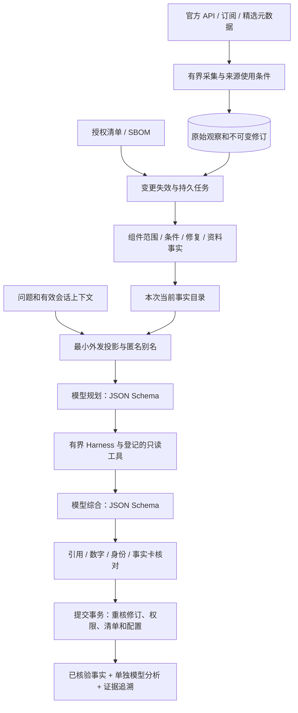

# V2 运行与架构说明 — 2026-10-04

V2 将自然语言问答改为可替换模型网关，完成 Mock 全流程和官方 DeepSeek V4 Pro API 接口，重建问答工作台，新增标准/博客订阅、官方知识目录和被动 SBOM 导入。所有实际密钥仍留空，本轮无真实或付费推理。原比赛 PDF 与既有证据库保留。

## 开启、关闭与切换

在项目目录启动无凭据演示：

```sh
python3 -m aicti_core --provider mock serve --demo
```

打开 http://127.0.0.1:8849/；终端按 Ctrl+C 关闭，再运行上述命令开启。使用 HTTP；服务由项目标准库入口启动，无需 uvicorn。演示撤回会保存；重演时添加 `--replay-demo`，追加有效修订并保留历史。

真实库只读现有资料、不联网采集：

```sh
python3 -m aicti_core --provider mock serve --no-collect
```

真实监测使用 `python3 -m aicti_core serve`。启动时加载五项精选官方元数据，后台自动处理来源/清单变化。演示与真实库隔离。进程关闭后采集停止，重启恢复保存的游标。模型设置只在内存，重启不会保存提供方或 Key。

以后在“模型设置”选择 DeepSeek V4 Pro，确认云端推理，输入 Key，保存，再按“测试连接”。浏览器只连接本机，后端使用固定 `https://api.deepseek.com/chat/completions` 与 `deepseek-v4-pro`。Key 不写文件、数据库或导出，也不回传状态。命令行支持 `--provider deepseek` 和专用 `DEEPSEEK_API_KEY` 进程变量；不要在仓库中创建密钥文件。模型状态读取不会发请求，测试和提问才会调用所选网关。

## 数据与控制流程



采用模块化单体与 SQLite，界面、采集、富化、问答之间以明确数据契约衔接。原始资料、派生事实、模型分析分别保存；来源更新立即使旧结论失效，再由任务重算。耗时模型请求在事务外执行，保存时取得写锁重核输入。配置切换期间返回的旧模型回答也不能发布。

模型提供方可替换，事实与权限由主机持有。Mock 和 DeepSeek 使用同一“规划—工具反馈—综合—核验”路径；Mock 是确定性离线协议模拟，没有真实大模型理解能力。规划后工具读取实际主机事实，输出不通过校验就降级，不能直接伪造查询结果。预算为最多四次生成、六次工具调用、30 秒总期限。只登记事实和关系读取工具，模型无法扩展权限、主动扫描或修改目标。

## JSON Schema 如何约束输出

可复用 Schema 位于 `docs/schemas/`；权威定义在 `aicti_core/qa.py`。运行时还把本次允许的匿名实体/卡片 ID 绑定到校验，独立 Harness 检查工具参数。标准库校验器实现项目使用的有界严格子集，不宣称是通用 JSON Schema 引擎。

| 阶段 | 模型可以返回 | 主机检查 |
|---|---|---|
| 检索规划 | 允许的实体、检索意图和有界关系参数 | 字段/类型/数量、未知字段拒绝、当前实体范围 |
| 工具读取 | 已登记工具名与参数 | 权限、实体范围、调用数、截止时间、实际工具反馈 |
| 回答综合 | 事实卡 ID，以及分析/建议/未知段 | 只能选择本次完整事实卡；每段恰好四字段 |
| 回答发布 | 主机重建的事实、引用和显示文本 | 证据精确并集、数字/身份、修订、授权、清单和模型代次 |

分析段形状为 `kind,text,claim_ids,evidence_ids`，`kind` 仅允许 analysis/recommendation/uncertainty。模型不能更改事实卡正文、版本或官方评分。引用必须是所选事实引用的精确并集；不允许自造 ID、链接或数字。Schema 约束格式，不证明结论正确；数字与引用检查也不能完全验证语义，因此建议单独标注，真实模型仍需人工留出集评测。隐藏 reasoning_content 只用于必要的请求内工具续接，不显示、不保存为“证据链”。

## 赛题功能与实际边界

| 赛题板块 | 当前功能 | 验收边界 |
|---|---|---|
| 多来源监测 | NVD、GitHub 全局与厂商公告、arXiv、OWASP、NIST 草案及博客；有界轮询、续传、去重、修订、条件限流 | 七来源、六类别；草案/博客是滚动快照，非全历史或全部现行标准；消失不等于撤回 |
| 多维富化 | 组件/版本范围、CVSS/CWE、部署条件、修复、资料关系、POC 元数据、清单风险模式 | 只保留支持的版本比较；论文元数据不等于全文实验；显式 POC 标签不等于可用代码 |
| 授权资产匹配 | 表单/CSV/TSV/JSON 与 CycloneDX/SPDX SBOM；变化自动重算；保留暴露、认证、版本未知 | SBOM 代表文档声明，导入时间不证明实际部署；最大 256 组件，不探测目标 |
| 智能问答 | 模型规划、只读工具反馈、多轮、关系读取、综合、逐条引用、会话历史与撤回失效 | DeepSeek 真实推理未验收；Mock 不证明准确率、召回率或时延达标 |
| 知识底座 | FIPS 203、三项 NIST 指南、欧盟 AI 法案原版的官方元数据与使用条件；真实库生成资料事实 | 五项人工精选；FIPS 203 是通用密码标准；政策未自动追踪最新合并修订版 |
| 工作台 | 问答、情报、知识、资产、运行状态、模型设置；事实与分析分开，证据修订可展开 | 本机单用户原型，未建设公网多租户身份管理 |

API Key 仅存内存。云请求使用最小必要证据和请求内匿名资产事实，替换已知内部资产名称；不发送原始清单、实际资产 ID 或隐藏推理记录。文本脱敏是有界实现，不能保证识别所有未知秘密，因此界面明确要求不在问句/清单中粘贴凭据。外部文本始终是不可信数据，前端按文本渲染，后端限制公网官方端点与工具权限。

## 验证与后续

运行 `python3 -m unittest discover -s tests -q`。离线测试使用临时数据库和注入传输，不需要网络或真实 Key。主聊天的最终验收记录见 `docs/handoffs/system-integration-v2.md`，涵盖浏览器问答、追问、引用、模型配置、SBOM、撤回和响应式界面。

下一步填 Key 后，在实际部署设备与留出问题集测中文、多跳、多轮、引用支持率、未知正确率和完整回答 P50/P95；同时确认赛事是否允许云端推理。不得用离线测试数量或 Mock 速度证明赛题性能指标。

接口核实依据：[官方模型目录](https://api-docs.deepseek.com/quick_start/pricing/)、[Chat Completion](https://api-docs.deepseek.com/api/create-chat-completion/)、[工具调用](https://api-docs.deepseek.com/guides/tool_calls/)、[JSON 输出](https://api-docs.deepseek.com/guides/json_mode/)。逐来源核验与限制见 `docs/handoffs/coverage-v2.md`。
